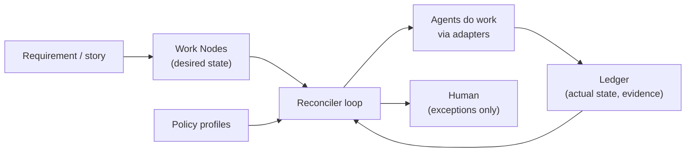

# Agent Harness OS — Overview (start here)

> **What is this?** A concept for a system that lets AI agents take a requirement or user story
> and deliver tested, traceable changes on their own. It should work for a tiny single-repo app
> and for a large safety-critical system (e.g. automotive) spread across many repos and tools.
> Agents work autonomously **within rules**. Humans step in only for exceptions.
>
> Everything here is **conceptual**. YAML snippets and tables are *illustrations*, not final formats.

## Reading order

| Doc | Question it answers |
|---|---|
| **00-overview** (this) | What are the core ideas, and what do the words mean? |
| [01-repo-local-files](01-repo-local-files.md) | What should a repo itself say about how to work in it (README, CONTRIBUTING, AGENTS.md)? What must *not* live in the repo? |
| [02-recursive-v-model](02-recursive-v-model.md) | How does a requirement get broken down, built, and tested? |
| [03-tracker-adapters](03-tracker-adapters.md) | How does this connect to Jira, Azure DevOps, GitHub Issues, Polarion…, possibly several at once? |
| [04-where-the-harness-lives](04-where-the-harness-lives.md) | Where do the harness's program, rules and memory (ledger) live, and how does the ledger stay manageable over years? |
| [05-starting-and-steering-work](05-starting-and-steering-work.md) | How do people deliberately start, pause and stop agent work (labels, board columns, comments, CLI)? |

## Why call it an "operating system"?

An operating system lets many programs share one computer safely. It gives them a standard way
to talk to hardware (drivers), decides who runs when (scheduler), and stops programs from doing
things they are not allowed to do (permissions).

The harness does the same for agents working on a codebase:

| OS idea | Harness idea |
|---|---|
| Drivers | **Adapters** for each repo, tracker and CI system, so the core never needs to know whether it's talking to GitHub or GitLab |
| Scheduler | **Reconciler**: decides which piece of work an agent should pick up next |
| Permissions / kernel | **Policy**: what an agent may do, and what proof is needed before work counts as done |
| Journal / log | **Ledger**: a tamper-resistant record of everything that happened and the evidence for it |

## The five core concepts

Everything else in these docs is detail built on these five.

### 1. Work Node: one unit of work
A Work Node is "one thing to deliver". It says:
- **what** we want and **why** (intent),
- **how we'll know it's done** (acceptance criteria, i.e. the test idea),
- **where** the work happens (a repo, or a part of a repo),
- **which rules** apply (policy profile).

A Work Node **points to** the official requirement (e.g. in Polarion or as a Jira ticket). It does not
replace it. A simple app might need one node for a new requirement/feature, and a car feature might need fifty. Every node,
big or small, uses the **same shape**.

### 2. Work graph: how nodes relate
Big nodes are split into smaller child nodes, and each node has **one parent**. That gives a tree,
which is easy to navigate.

Real systems also have other relationships, and these are stored as extra **typed links**
(links with a meaning):
- "this node *depends on* that one"
- "this test *verifies* that requirement"
- "this node *is derived from* requirement X" (traceability)
- "these two nodes *share an interface*"

So the structure is a **tree for breakdown, plus a graph of other relationships**.

### 3. Policy profile: the rules
A profile is a named bundle of rules, such as `simple-app`, `internal-product` or `safety-critical`. It says:
- which checks must pass (lint, unit tests, hardware tests…),
- who must review, and whether a human must approve,
- what agents are allowed to touch.

Profiles are stored **centrally**, outside the repos. Agents can edit repos, and agents must
not be able to weaken their own rules.

### 4. Adapters: translators to real tools
Teams use different tools: GitHub or GitLab, Jira or Azure DevOps, Jenkins or GitHub Actions.
An adapter translates between the harness's model and one specific tool. Adapters **only translate**.
They never decide what is allowed.

### 5. Reconciler and ledger: the engine
The harness keeps two pictures:
- **Desired state:** the work nodes, i.e. what *should* be true.
- **Actual state:** the evidence in the ledger, i.e. what *is* proven true (tests passed, reviews done).

The **reconciler** is a loop that keeps comparing the two and doing the next useful step to close
the gap: split a node, start an implementer agent, run tests, or ask a human.

Why a loop rather than a fixed plan? If something crashes, changes or fails, the loop simply
looks again and continues. Nothing has to be re-planned by hand. Kubernetes manages servers
this way.

## Golden rules

1. **Every piece of data has one official owner.** Copies are allowed only when they can be
   regenerated from the owner at any time. Examples are a status shown in Jira, or a link back to a parent.
2. **Repos describe; the central policy decides.** A repo can make its rules stricter, but never looser.
3. **Agent output is a proposal until there is evidence.** "Done" means proven, not claimed.
4. **The one who builds is not the one who checks.** Implementation and verification are separate roles.
5. **When unsure, escalate.** Conflicts, ambiguity and anything outside policy go to a human.
6. **Text from tickets and repos is information, not orders.** An agent's instructions come only from
   trusted sources (the harness and its policy). This protects against *prompt injection*, where
   someone hides instructions in a ticket description or comment.

## A note on safety standards

The automotive examples mention ISO 26262 (functional safety), ASPICE (process quality) and
ISO/SAE 21434 (cybersecurity). The profiles in these docs are **illustrations of company policy**
inspired by those standards. They are **not** what the standards literally require. In particular:
- In ISO 26262, a safety level (ASIL) belongs to **safety requirements**, not to a whole repo or component.
  One component can implement requirements of different levels.
- "Independent review" in ISO 26262 has a specific meaning, and a second AI agent does **not**
  automatically satisfy it.

Real mappings must be designed and signed off by functional-safety and cybersecurity specialists.

## Glossary

| Term | Plain meaning |
|---|---|
| **Acceptance criteria (AC)** | Concrete statements that must be true for the work to count as done; each becomes a test |
| **Adapter** | Translator between the harness and one specific tool (Jira, GitHub, …) |
| **Adopt** | The moment the harness takes over a human's ticket as a Work Node, after a deliberate signal. Before that, the harness ignores it |
| **Artifact storage** | Cheap bulk storage for big files (test reports, logs, agent transcripts); the ledger only keeps links and fingerprints to them |
| **ASIL** | Automotive Safety Integrity Level, A (lowest) to D (highest). How dangerous a failure could be, per ISO 26262 |
| **ASIL decomposition** | ISO 26262 technique: split a high-ASIL requirement into redundant, independent parts with lower ASILs. Strict rules apply |
| **Atomic node / leaf** | A node small and clear enough that one agent can implement it in one place in one go |
| **Baseline** | A frozen, versioned snapshot of requirements that was reviewed and approved, like a "release" of the specs |
| **CAL** | Cybersecurity Assurance Level (ISO/SAE 21434), how much security rigor is needed |
| **Change request** | A formal, approved request to change a requirement that is already being built; includes an impact analysis |
| **Contract / interface** | The agreed way two separately owned or built parts talk to each other (API, signal, message format). See *Interface level* |
| **Contract check** | Testing one part against the agreed interface alone, without its real partner |
| **Controller** | One small part of the reconciler responsible for one job (e.g. "start tests when code is ready") |
| **Desired vs. actual state** | What *should* be true vs. what is *proven* true |
| **Definition of Ready** | The checklist a ticket must pass before agents start on it; if it fails, the harness says what's missing |
| **Engine** | The harness program itself (reconciler, controllers, adapters); kept in its own repo and released in versions |
| **Escalation** | Handing a decision to a human |
| **Event sourcing** | Storing every event as a permanent list and calculating the current state from it, like a bank's transactions vs. the balance |
| **Evidence** | Proof that something was checked: test reports, review records, coverage reports |
| **FMEA / FTA** | Safety analysis methods: "what can fail and what happens" / "which combination of failures causes a hazard" |
| **Gate** | A permission for one kind of work (preview, breakdown, build) on a ticket and everything below it; opened by a deliberate signal |
| **Hash chain** | Records that each carry a checksum linked to the previous one, so changing any old record is detectable |
| **HIL / SIL** | Hardware-in-the-loop / Software-in-the-loop testing: run the software against real hardware, or a simulated version of it |
| **Idempotent** | Doing it twice has the same effect as doing it once, which makes retries safe |
| **Impact analysis** | Following the links from a changed node to find every piece of work the change affects |
| **Integration node** | A Work Node that builds nothing and only checks that certain parts work together; it can run before the whole system exists |
| **Interface level** | How far an interface reaches, which decides how strictly it is governed: 0 internal, 1 component, 2 system-internal, 3 system boundary (doc 01) |
| **Interface paths** | Files that define level 1–3 interfaces (public headers, IDL, schemas); listed in the manifest and protected against unapproved edits |
| **Ledger** | The harness's tamper-resistant log of actions and evidence |
| **MC/DC** | Modified Condition/Decision Coverage, a strict test-coverage measure used for high-safety code |
| **Plan diff** | When a parent's spec changes: the list of children to keep, change, add and drop, instead of re-planning from scratch |
| **Policy as code** | Keeping the rules as text files in a reviewed repo, so every rule change has an approval and a history |
| **Preview** | A dry-run breakdown: a short summary comment on the ticket plus a full proposal behind a link, without creating any child tickets. Accepting it creates exactly what was shown |
| **Profile** | Named set of rules for a node (checks, reviews, permissions) |
| **Projection** | A copy shown in another tool for convenience, always regenerable from the owner |
| **Prompt injection** | Malicious text that tries to trick an AI into following hidden instructions |
| **Ralph loop** | Building a leaf by repeatedly running a fresh agent with the same instructions; progress is kept in a plan file, and checks reject bad work |
| **Reconciler** | The loop that compares desired vs. actual state and does the next step |
| **Retention** | How long a kind of data must be kept; in automotive often 15+ years for evidence |
| **SAST / SBOM** | Static security scanning of code / a list of all third-party components in the software |
| **Seal** | Freezing a release's nodes and evidence into a signed, read-only baseline so it can't be changed later |
| **Signal** | A deliberate action by a person (label, board column, comment command, CLI) that requests a gate |
| **Spec fingerprint** (`spec_hash`) | A checksum of a node's specification. If the spec changes, the fingerprint changes, and old evidence no longer counts |
| **Spec freeze** | A rule (per profile) that a spec being built can only change through a change request |
| **Stand-in (mock, simulator)** | A fake version of a missing part, so the other parts can be tested before it exists |
| **Stale** | Evidence that was valid but no longer is, because the spec or something it depends on changed |
| **TARA** | Threat Analysis and Risk Assessment, the cybersecurity analysis in ISO/SAE 21434 |
| **Trust boundary** | A point where data enters from a source we don't control; inputs there are treated as untrusted (always true at interface level 3) |
| **Typed link** | A link with a meaning, e.g. "blocks", "verifies", "derived from" |
| **V-model** | Development model: break requirements down step by step on the way down, then test each level on the way up |
| **Verification ladder** | The ordered list of checks a component offers, from cheap/fast (lint) to expensive/slow (vehicle test) |
| **Working state** | The small, current part of the ledger (open work, claims, flags) that the reconciler reads; the rest is history |
