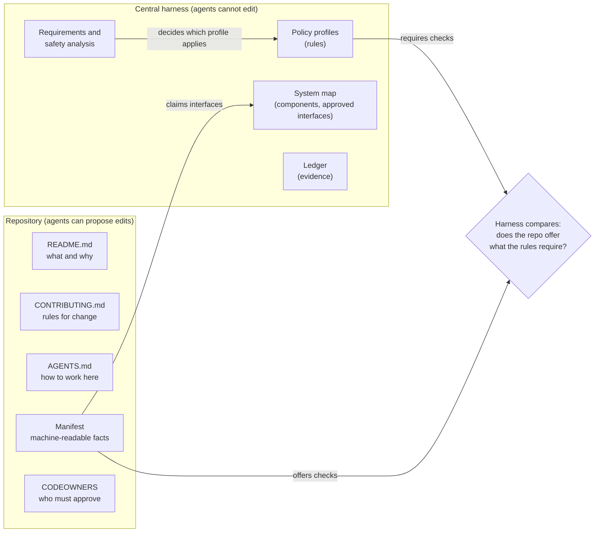
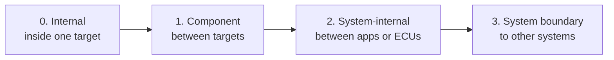
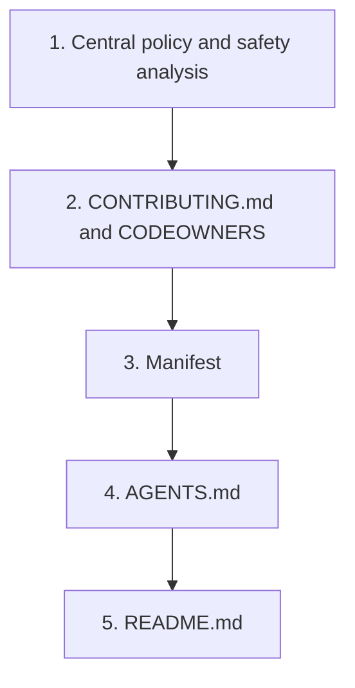
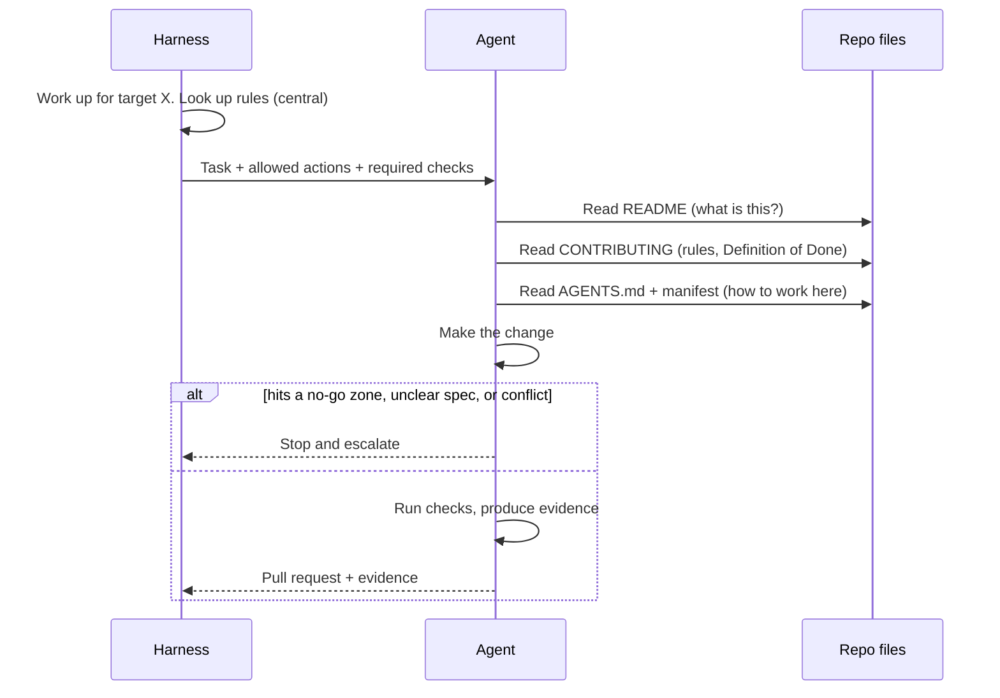

# Agent Harness OS — What Lives in the Repo?

> Part of the concept series. Start with [00-overview](00-overview.md) for core ideas and glossary.
> Examples and YAML here are **illustrations**, not final formats.

## The question

An agent dropped into a repository needs to know three things:
1. **What is this?** (context)
2. **What are the rules for changing it?** (process)
3. **How do I actually work here?** (commands, layout, pitfalls)

Some of this knowledge belongs **in the repo**, because it changes together with the code. Some of it
must be kept **outside the repo**, because agents can edit the repo, and an agent must not be able to
loosen its own rules.

## The one-line answer

> **Put in the repo what must change together with the code.
> Keep outside the repo what must stay trustworthy even if the repo is changed by an agent.**



**How to read the arrows:** the **manifest** is the repo describing itself: "these are the checks I can
run, these interfaces I implement". The **policy profile** is the central demand: "work at this level
needs these checks". The harness **compares** the two. If a required check is missing (e.g. the profile
needs a coverage report but the manifest has no coverage check), the work can never be proven there, so
the harness escalates. Interface claims are compared with the **system map** in the same way. The manifest
only states facts; it can never weaken the rules.

## Repo, component, and "target": not always 1:1

It is tempting to say "one repo = one component", but that often doesn't hold:
- A **monorepo** holds many components.
- One component can be **spread over several repos** (e.g. code + configuration + generated code).

So the harness talks about a **target**: *the place where a piece of work is built and tested*.
A target is `repository + path + its manifest`. For a simple app that is just "the repo". In a
monorepo it might be `platform-repo / services/brake-ctrl`.

## The repo files and what each is for

### `README.md` — **describes**
*"What is this, and why does it exist?"*

Written mainly for humans. Agents read it to get oriented.
- Purpose, and what this code explicitly does **not** do
- Where it fits in the bigger system (what it talks to), with links to the central system map
- A short architecture overview
- How to build and run it locally
- Who owns it

**No rules here.** README is context. If rules live here, they get missed or contradict
CONTRIBUTING.

### `CONTRIBUTING.md` — **governs**
*"How is a change accepted here?"*

Written for **every contributor**, humans and agents alike. That's the point: if agents
had a separate process, you'd have two quality standards, and auditors would notice.
- How to branch, commit, and size a PR
- **Traceability rule:** every commit/PR references the requirement or ticket it implements, so
  you can always answer "why does this line of code exist?"
- **Definition of Done** for this repo, i.e. which checks must pass
- Coding standards (for automotive C/C++, often MISRA, a safe-subset coding standard)
- How to change an **interface** other components depend on (announce, version, agree first)
- Extra steps for **safety-** or **security-relevant** areas (impact analysis, extra review)

This file is protected: changing it needs approval from the process owners.

### `AGENTS.md` — **instructs**
*"How do I work correctly in this repo?"*

Written mainly for agents. Humans find it useful too. It changes often, whenever tooling changes.
- **Exact commands:** setup, build, lint, test, run a single test
- Tools and versions needed. Also say what *can't* run locally, e.g. tests that need special hardware.
- Map of the repo: where things are, and which folders are generated or third-party (don't edit)
- **No-go zones:** areas where the agent must stop and escalate instead of editing
  (e.g. safety mechanisms, calibration data, bootloader, cryptography)
- **When to escalate:** unclear spec, a test failing for reasons unrelated to my change,
  a change that would touch an interface
- How to produce **evidence** (test reports, coverage) in the format the harness collects
- Known traps ("after changing X, always regenerate Y")
- **Links** to README and CONTRIBUTING rather than copies of them

### Manifest (e.g. `component.yaml`): **declares**
*"The same facts, but machine-readable."*

Prose is great for understanding but bad for automatic checking. The manifest gives the harness
facts it can verify:

```yaml
# illustration only
target: brake-ctrl                 # name in the central system map
path: .                            # or a sub-folder in a monorepo
interfaces:                        # what this code implements today (levels 1-3, see below)
  provides: [BrakeRequest@2.1]
  consumes: [VehicleSpeed@1.4]
interface_paths: [include/public/**, idl/**]   # files that define them; protected
checks:                            # the "verification ladder": cheap → expensive
  - { name: lint,      run: "make lint" }
  - { name: unit,      run: "make test",     report: reports/junit.xml }
  - { name: coverage,  run: "make coverage", report: reports/coverage.xml }
  - { name: sim-test,  run: "make sil",      where: simulation-farm }
  - { name: hw-test,   where: hil-rig,       agent_can_run: false }
no_go_paths: [safety/**, calib/**, boot/**]
```

What the manifest does **not** contain: the safety level, required approvals, or permissions.
Those are decided centrally (see below).

### `CODEOWNERS` + branch protection: **enforces**
The only repo-level items the source-control system actually *enforces*: "changes to path X need
approval from team Y". Agents can never approve their own changes, and changes to these files
need owner approval.

## What lives centrally, and why

| Thing | Why it's not in the repo |
|---|---|
| **Policy profiles** (which checks and approvals are required) | Agents edit repos and must not weaken their own rules |
| **Safety/security classification** | In ISO 26262, safety levels belong to *requirements*, not repos. One repo may contain code with different safety levels. The safety analysis decides this, not a YAML file in the repo. |
| **System map** (all components + **approved** interfaces) | No single repo sees the whole system, especially across GitHub, GitLab, Gerrit… |
| **Planning and scheduling** | Needs the whole-system view |
| **Ledger** (evidence, audit trail) | Must be tamper-resistant |
| **Credentials** | Never in source code |

### What counts as an "interface"? Four levels
"Interface" can mean anything from a private header file to the connection to another company's system.
For the harness, an interface is **a boundary between parts that are owned or built separately**.
It's not about the technology (header, API, CAN signal), but about **who is on each side** and **how far
a break would spread**. The more owners and the wider the spread, the stricter the rules:



| Level | Examples | Owned by | How it's governed |
|---|---|---|---|
| **0. Internal** | Non-exported `.h` file, private class, helper function | The team owning the target | **Not governed.** Just code. An agent may change it within its own leaf; the tests catch breakage. |
| **1. Component** | Exported header or public module API inside one app or monorepo | The component owner | **Light.** Declared in the manifest, contract checks, owner approval for changes. |
| **2. System-internal** | Between apps or ECUs of the same system: CAN signals, SOME/IP services, REST between services | The system architect, via the central system map | **Full.** Versioned, changed only through an interface negotiation (doc 02), integration nodes test it. |
| **3. System boundary** | To other systems: a supplier's ECU, an OEM backend, a phone app, a diagnostics standard | **Someone outside** our system | **Fixed for agents.** Agents can only use it, never change it. Changes are agreed between people or companies. Testing uses stand-ins or simulators. |

**What this means in practice:**
- The rule **"implementers don't change interfaces, they push back"** (doc 02 §8) applies from **level 1 up**.
  Two agents clashing on a level-0 interface is just an ordinary merge conflict.
- The manifest declares only levels 1–3 (`interfaces`, `interface_paths`). Level 0 isn't declared.
- **An interface can move up a level.** A private header becomes level 1 as soon as **two separately built
  leaves** depend on it. The decomposer must then record it as shared (a `shares-interface` link, doc 02 §2),
  so it is agreed *before* parallel work starts.
- **Safety and security apply at any level.** An interface carrying safety-relevant data (e.g. "hold active")
  inherits that data's safety requirements, even at level 1. Level 3 is always a **trust boundary**
  (ISO/SAE 21434): anything coming in is treated as untrusted and needs a threat analysis.

### Interfaces (levels 1–3): three different things that are easy to mix up
| What | Where it lives |
|---|---|
| The **approved** interface (the agreed version everyone builds against) | Central system map |
| What the code **currently implements** | Repo manifest |
| A **proposed change** to an interface, being negotiated | The Work Node for that change (doc 02) |

The harness compares these. If the manifest says the code implements `BrakeRequest@2.2`, but only
`2.1` is approved and no change is in progress, that's a mismatch, so a human is asked.

## Who wins when things disagree?



- Higher wins. A lower level may make rules **stricter**, never looser.
- A real conflict (not just "stricter") is **escalated** to a human, never guessed.
- Any agent change to CONTRIBUTING, AGENTS.md, the manifest or CODEOWNERS gets **extra review**,
  because those files steer agents. Without that, an agent could quietly rewrite its own guardrails.

## How an agent uses all this when it picks up work



## Onboarding a repo: the readiness scan

Before the harness does any work in a repo, it **scans** it: a Definition of Ready for the repo, like the
one for tickets (doc 05 §5). It reads the files above and compares them with what the policy requires.
Nothing is changed; the result is a list of **findings**, each with a severity and a suggested fix:

| Severity | Meaning | Examples |
|---|---|---|
| **Blocker** | Agents can't work here safely yet | No way to run tests found. Tests fail on `main` already, so no landing check could ever pass (doc 08). A required check isn't offered. |
| **Warning** | Agents can work, but will likely do it badly or cause friction | No AGENTS.md, or it doesn't say how to build and test. No CONTRIBUTING or Definition of Done. A file that every change must touch (a merge hotspot, doc 08 §8). No CODEOWNERS on the files that steer agents. |
| **Info** | Worth knowing | Build system and test framework found. Size and age of the repo. |

The scan is deliberately **generous with findings**: a gap found before work starts is cheap, while the
same gap found by an agent halfway through a leaf costs a failed run and a confusing escalation.

- The scan may **draft** missing pieces, such as a manifest built from what it detected. Like any change
  to files that steer agents, a human reviews it before it counts.
- Findings are recorded in the ledger, so it's on record what the harness knew when it started.
- The scan runs again whenever those files change on `main`, and findings can also come up **during**
  work, for example a flaky test, or a leaf that keeps touching files outside its touch set.

## Summary

| File | Role | Main audience | Changes |
|---|---|---|---|
| README.md | Describes | Humans | Rarely |
| CONTRIBUTING.md | Governs | Everyone | Rarely, protected |
| AGENTS.md | Instructs | Agents | Often |
| Manifest | Declares (machine-readable) | Harness | With build/test changes |
| CODEOWNERS | Enforces approvals | SCM system | Rarely, protected |
| *Central policy* | **Decides** | Harness | Controlled centrally |
