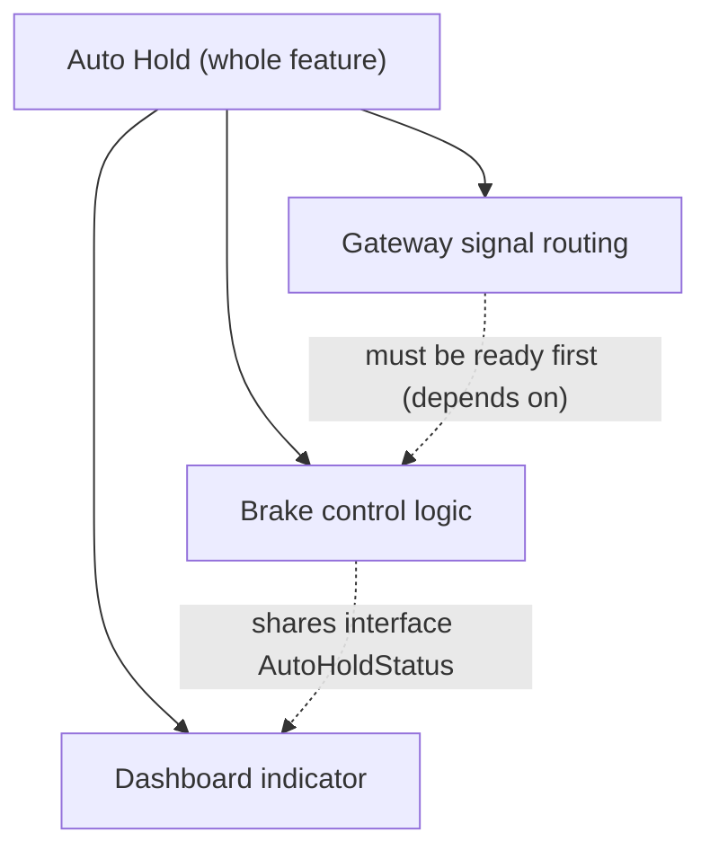
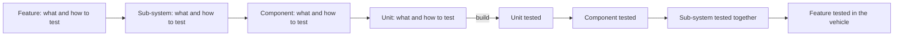
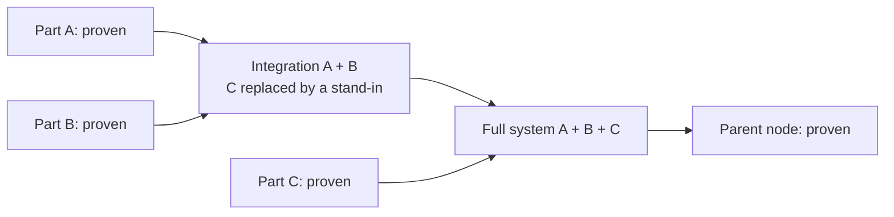
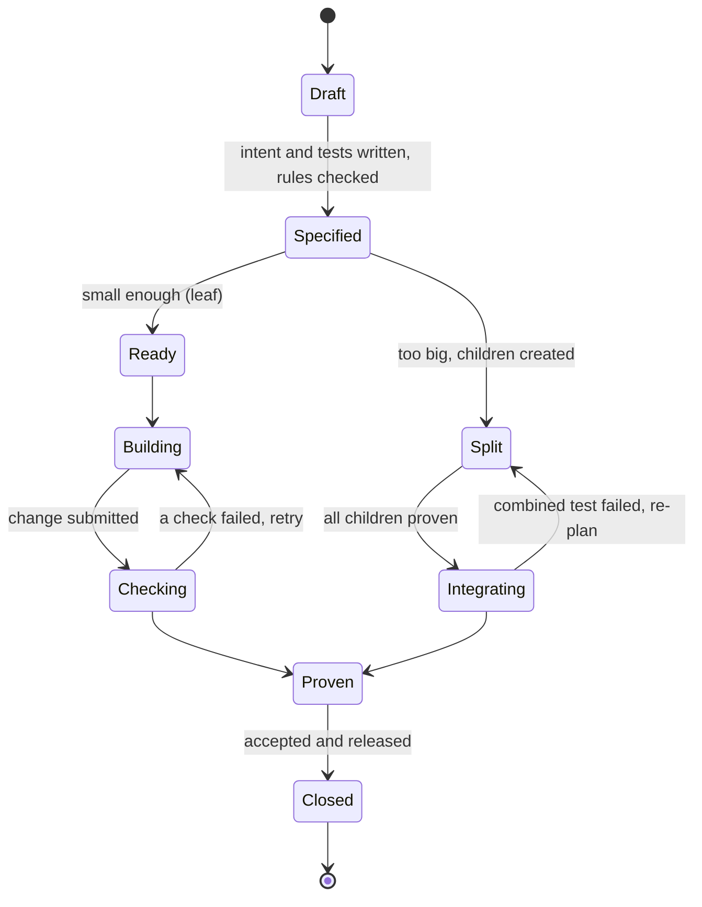
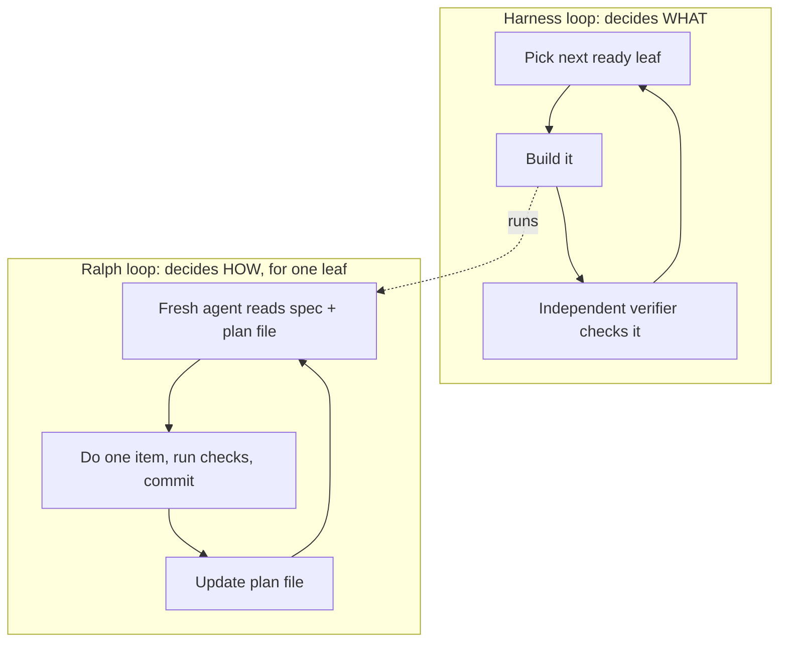
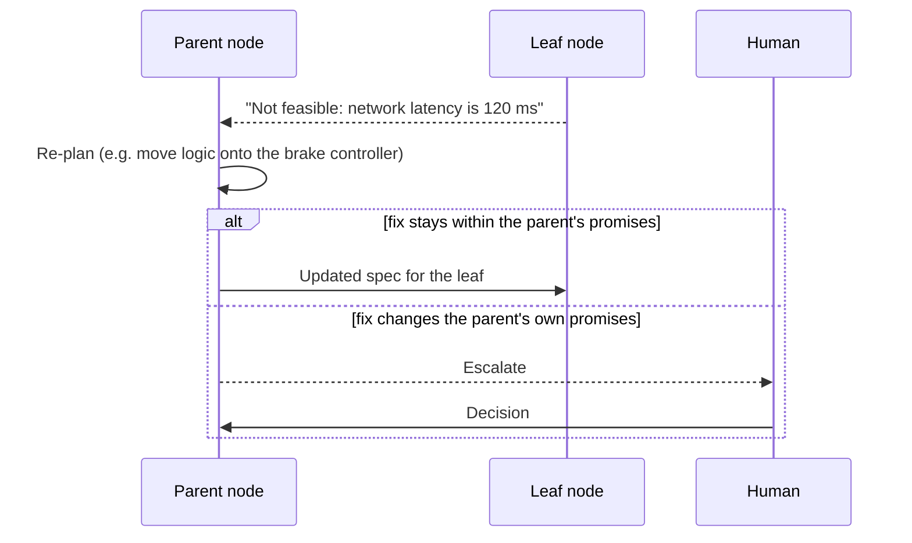
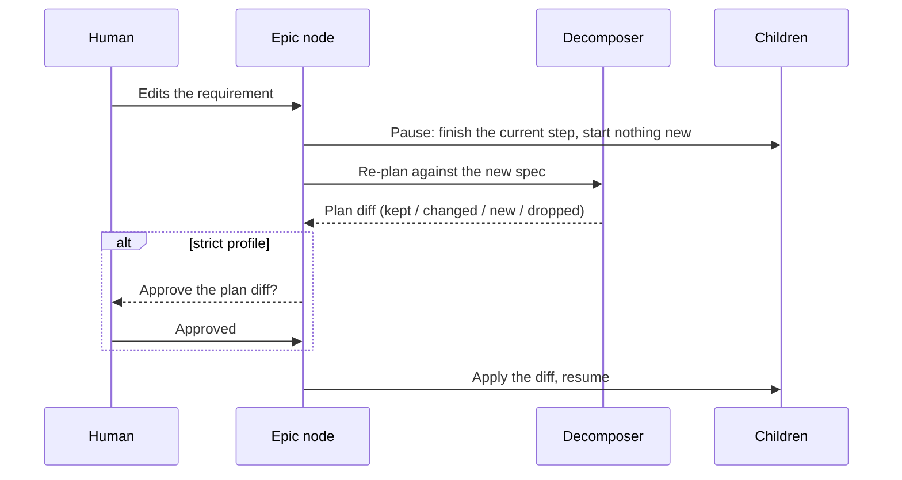
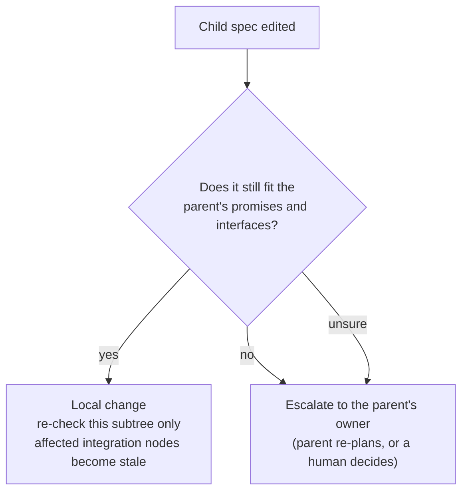
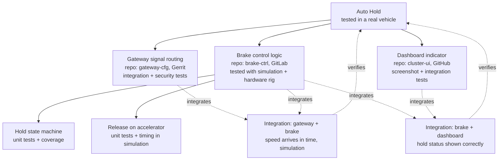

# Agent Harness OS — Work Nodes and the V-Model

> Part of the concept series. Start with [00-overview](00-overview.md) for core ideas and glossary.
> Examples and YAML here are **illustrations**, not final formats.

## The problem

A user story like *"Add dark mode"* can go straight to one developer or agent.
A requirement like *"The car holds itself on a slope"* can't. It touches brakes, the dashboard, and the
network gateway, each in a different repo with different rules and different ways of testing.

We want **one model** that handles both without making the simple case complicated.

## The idea in four sentences

1. All work is described with **one shape**, the **Work Node**, at every size.
2. Big nodes are **split into smaller nodes** (top-down) until each piece is small enough to build in one place.
3. Each node says **how it will be tested** at the moment it is created. Testing then happens **bottom-up**:
   small pieces first, then the combinations.
4. A **loop** (the reconciler) keeps checking "what's still missing?" and does the next step.

## 1. The Work Node

A Work Node is **one unit of work to deliver**. Think of it as a well-written ticket that a machine can
also understand.

```yaml
# illustration only
id: wn-7f3a                          # harness's own permanent ID (see doc 03)
title: Hold vehicle when stopped on a slope
intent: >                            # what and why, in plain language
  Keep the car still after stopping on a slope until the driver accelerates.
implements: [polarion:SYS-118]       # the official requirement(s) this node delivers
acceptance:                          # how we know it's done; each one becomes a test
  - id: AC-1
    says: Car stays still on a 30% slope for at least 3 minutes.
    checked_by: hardware-test
  - id: AC-2
    says: Hold releases within 100 ms of pressing the accelerator.
    checked_by: simulation-test
target: brake-ctrl                   # where it is built and tested (only for leaves, see §4)
profiles: [safety-critical]          # which rule bundle(s) apply
```

**Only a few fields are required:** `id`, `title`/`intent`, `acceptance`, `profiles`.
A simple app needs nothing more.

### A Work Node is *not* the requirement itself
Official requirements often live in a requirements tool (Polarion, DOORS, codebeamer, or simply the Jira
story). They have their own owners, approval process and versions.

A Work Node **points to** them (`implements`). It is the *delivery plan* for those requirements, not a
second copy. If a node adds its own acceptance criteria, these are *derived* from the official
requirement: more detailed, and tied back to it.

Why it matters: otherwise you'd have two versions of "the requirement" that slowly drift apart.

## 2. Structure: a tree for breakdown, plus links for everything else

**Breakdown (tree):** each node has **at most one parent**, which makes the work easy to navigate.

**Other relationships (typed links):** real systems are messier than a tree. A node may also:
- *depend on* another node (can't finish before it),
- *share an interface* with another node,
- be *verified by* a specific test node,
- *implement* several official requirements, and one requirement may be implemented by several nodes.



Solid arrows = breakdown (tree). Dotted arrows = other relationships (links).

## 3. Profiles: same node shape, different rules

A **profile** is a named bundle of rules. It is how one model can serve both a hobby app and a brake
controller. **The node shape stays the same; only the rules change.**

| Profile (illustrative) | Typical required checks | Who checks the work | Human involvement |
|---|---|---|---|
| `simple-app` | lint, unit tests | a separate reviewer agent | only on exceptions |
| `internal-product` | + integration tests, traceability links | a separate reviewer agent | only on exceptions |
| `safety-relevant` | + simulation tests, stricter coverage, impact analysis | a separate verifier agent | approves safety-related changes |
| `safety-critical` | + hardware tests, strictest coverage (e.g. MC/DC), safety analysis links | a separate verifier agent **plus** the organization's independent safety review | approves before release |
| `security-relevant` (add-on) | + security scans, dependency list (SBOM), threat analysis update | a separate verifier agent | approves crypto/key changes |

> ⚠️ These are **examples of company policy**, not what ISO 26262 / ASPICE / ISO 21434 literally require.
> Real profiles must be defined with functional-safety and security experts.

**Several profiles at once:** a node can have more than one (e.g. `safety-critical` + `security-relevant`).
The harness **merges** them into one *effective rule set*:
- If one rule is simply stricter than another (e.g. 90% vs. 100% coverage), take the stricter one.
- If two rules genuinely **conflict** (they can't both be satisfied), don't guess. **Escalate.**

**Children inherit** their parent's profiles. Lowering the rules for a child (e.g. "this part isn't
safety-relevant after all") must be justified and approved. In safety engineering that is a formal
analysis, not a judgement call by an agent.

## 4. Breaking work down (top-down), and when to stop

The **decomposer** role takes a node that is too big and proposes children. For each child it writes:
- a smaller intent,
- **its own acceptance criteria** (how this smaller piece will be tested),
- which interfaces it shares with its siblings.

Writing the tests **at the same time** as the breakdown is the heart of the V-model (§5). It means every
level is testable, and traceability ("this test proves that requirement") comes for free.

### When is a node small enough? (the "leaf" check)
A node becomes a **leaf**, ready to implement, when all of these are true:

| Check | Plain meaning |
|---|---|
| One target | All the work happens in one place (one repo, or one part of a monorepo) |
| One effective rule set | Its profiles have been merged without conflicts |
| Testable locally | Every acceptance criterion can be checked with that target's own checks |
| Interfaces agreed | No open questions about how it talks to its neighbours |
| Right-sized | It fits in one reviewable pull request |

If any check fails, split further. **Safety stop:** a maximum depth and a maximum number of children.
Hitting the limit means a human should look.

## 5. The V-model: down the left, up the right



Read it as a "V":
- **Left side, going down:** break the work into smaller pieces. Each level writes down *how it will
  be tested*.
- **Bottom:** only the smallest pieces (leaves) are actually *built*.
- **Right side, going up:** test the small pieces, then test them **together**, level by level, using
  the tests written on the way down.

Each left/right pair is the **same node**: one side is "specified", the other is "proven".

### Integration work that produces code
Sometimes putting pieces together needs code of its own: glue code, configuration, wiring. That work becomes
**its own leaf node** under the parent, so that all code is still written in leaves. The parent
node itself only **coordinates and tests**; it never edits code directly.

### Step-by-step integration: integration points

**The problem.** Picture a system with three parts: A, B and C. A and B could already be tested together
long before C exists. Waiting for all three and then testing everything at once ("big bang" integration)
finds problems late, and makes it hard to tell which part is at fault.

**Why not just reshape the tree?** You could put A and B under a new in-between parent. But the tree
describes **how the work is broken down** (by function), and the best order for testing things together
is often different. Bending the tree to fit the test order makes the breakdown harder to understand.

**The idea: integration nodes.** An integration node is a Work Node that **builds nothing**. It only
checks that certain parts work *together*. It isn't placed in the tree by function. Instead it is
connected to the parts it combines with `integrates` links (the "other relationships" from §2):

```yaml
# illustration only
id: wn-i1
kind: integration                    # checks only, never writes product code
title: Gateway delivers vehicle speed to brake control in time
integrates: [wn-gateway, wn-brake]   # the real parts that are tested together
stand_ins: [wn-dashboard]            # missing parts are replaced by mocks/simulators
acceptance:
  - id: AC-1
    says: Speed signal reaches brake control within 20 ms, also under full network load.
    checked_by: simulation-test
target: integration-bench            # where the combined test runs (test repo, simulation, HW rig)
verifies: wn-autohold                # contributes proof to this higher node
```

**Three levels of "do they fit together?", from cheap and early to expensive and late:**

| Level | What is real | When it can run | Typical example |
|---|---|---|---|
| **Contract check** | One part, tested against the *agreed interface* | As soon as that one part is built | "Brake control accepts every message format allowed by the speed interface" |
| **Partial integration** | Some real parts together, the rest replaced by stand-ins | As soon as those parts are proven | Gateway + brake control in simulation, dashboard mocked |
| **Full system** | Everything real | When all parts and partial integrations are proven | Whole Auto Hold feature on a test rig or in a vehicle |

Contract checks belong to each part's own checks: they need no partner. Partial and full integration are
**integration nodes**.

**Integration nodes can build on each other.** They form a small plan of their own:



**How they fit into the rest of the model:**
- **Who creates them?** The decomposer, at the moment it splits a node and agrees the interfaces between
  the children. A sensible default is one integration node per important interface, plus the parent's own
  full check. Profiles can demand more, e.g. "safety-critical: every interface must be tested on the hardware rig".
- **When do they run?** The loop starts one as soon as all its *real* participants are proven. It doesn't wait
  for the whole system.
- **What exactly was tested?** The evidence records the **exact versions** (commits) of each participant that
  were tested together. If any participant changes later, the integration result becomes `stale` and is re-run.
- **Who writes the integration tests?** Test code is still code, so writing it is a **leaf** in the integration test
  repo (e.g. "write the A+B integration tests"). It is done by a different agent from the ones that built A and B,
  so the builders don't write the tests that judge them.
- **What if it fails?** The integration node doesn't fix anything. It reports *what* failed to the participants and
  to their **common parent**. The parent owns the interface between them, so it decides: fix part A, fix part B,
  or clarify the interface (→ interface negotiator). If the interface or the parent's own promises change, a human decides.
- **The parent's own completion:** a parent can only become proven when its children **and** its integration
  nodes are proven, followed by the parent's own acceptance tests.

## 6. The life of a node

A node has a **phase** (where it is in its journey) and can have **flags** (temporary conditions).
Keeping them separate avoids losing track of where a node was when something went wrong.

**Phases:**



Plus two ways to end without finishing: **Cancelled** (no longer needed) and **Superseded**
(replaced by another node).

**Integration nodes** (§5) use a shorter path: Specified → Integrating (as soon as all real participants
are proven) → Proven. They never pass through Building, because they write no product code.

**Flags** can be added in any phase without losing the phase:

| Flag | Meaning | Cleared when |
|---|---|---|
| `escalated` | Waiting for a human decision | A human decides; the node continues from the same phase |
| `blocked` | Waiting on something else (another node, a test rig) | The blocker is resolved |
| `stale` | Its proof no longer counts, because the spec or something it depends on changed | It is re-checked |
| `paused` | A person paused it (and everything below it) with a Pause signal ([doc 05](05-starting-and-steering-work.md)) | A person resumes it |

A node only enters this lifecycle once a person deliberately hands it to the harness ("adopts" it,
see [doc 05](05-starting-and-steering-work.md)). Before that, it's just a ticket that people are still refining.

**Proven vs. Closed:** "Proven" can be lost again if something changes (→ `stale`). "Closed" is final:
the work was accepted and released. Later changes start a *new* node.

## 7. The engine: a loop, not a fixed plan

Instead of planning every step up front and hoping nothing changes, the harness runs a **loop**:

> **Look** at what should be true (the nodes) and what is proven true (evidence in the ledger).
> **Pick** the next useful step to close the gap. **Do it.** **Repeat.**

Small specialised parts of the loop, called *controllers*, each handle one kind of step:

| Controller | Notices… | Does… |
|---|---|---|
| Breakdown | A node is too big | Starts a decomposer agent to propose children |
| Interface | Siblings haven't agreed how they talk | Starts an agent to propose an interface; asks both sides to agree |
| Build | A leaf is ready | Starts an implementer agent in the target repo |
| Check | A change was submitted | Starts a **separate** verifier agent; runs the required checks |
| Integration | All real participants of an integration node are proven, or all children of a parent are | Runs the combined tests on exactly those versions; records which versions were tested together |
| Policy | Any step at all | Allows it, blocks it, or escalates it |

**Why a loop is better here:**
- **Crash-safe:** after a restart it just looks again. Nothing is lost.
- **Handles change:** when a spec is edited, its *fingerprint* changes (see glossary: `spec_hash`).
  Old proof is marked `stale`, and only the affected work is redone.
- **Auditable:** every step is recorded with its evidence, which safety audits require anyway.

### How a leaf gets built: one pass, or a loop ("Ralph")

The loop above decides **what** to work on. A separate question is **how** an implementer agent works
through a single leaf. There are two strategies:

**1. Single pass.** One agent session reads the leaf, makes the change and submits it. This is simple and
fine for small leaves.

**2. Ralph loop** (named by Geoffrey Huntley after the Simpsons character: simple, persistent, unbothered).
The same instructions are run again and again, and **each round starts with a fresh agent**:
1. Read the leaf's spec, the repo's `AGENTS.md`, and a **plan file** that lists what's done and what's left.
2. Pick the **one** most important open item.
3. Implement it, run the repo's checks (build, tests), and commit if they pass.
4. Update the plan file (and `AGENTS.md` with anything useful learned), then stop.
5. A new round starts with a fresh agent, which picks up the plan file.

**Why it helps:**
- **No "context rot".** Long agent sessions get confused as their memory fills up. Each round starts clean,
  and everything worth remembering lives in files.
- **Crash-safe.** If a round fails, the next one continues from the files.
- **Checks steer the agent.** Rather than a clever plan, the build and tests reject bad work and
  the next round tries again. Good, fast checks are therefore essential.

It is the same principle as the harness's own loop, one level down:



**Where Ralph clashes with our rules, and the guardrails that fix it:**

| Risk | Guardrail |
|---|---|
| The agent decides for itself that it's "done" | The inner loop may only **submit**. Only the **separate verifier** and the evidence in the ledger can mark the leaf proven (builder ≠ checker). |
| It never stops | Limits per leaf on rounds, time and cost. **No-progress detection** (same failure again and again, empty changes) sets the `blocked` or `escalated` flag. |
| It "fixes" failing tests by changing them or the spec | Acceptance criteria and the tests derived from them are **read-only** for the implementer. The plan file is a scratchpad, not the spec. |
| It runs unattended for a long time | Isolated sandbox, minimal permissions, and no-go zones enforced by tooling, not just by instructions. |
| Repeated attempts on high-risk code | The profile decides whether Ralph is allowed at all, and with which limits. |

The strategy is chosen **per profile**:

```yaml
# illustration only
profiles:
  simple-app:       { build_strategy: ralph, max_rounds: 30 }
  internal-product: { build_strategy: ralph, max_rounds: 20 }
  safety-critical:  { build_strategy: single-pass }     # small, reviewable steps only
```

In lifecycle terms (§6), all Ralph rounds happen **inside the Building phase**. Its end result is a
submitted change, which moves the leaf to Checking like any other.

## 8. Pushing back: bottom-up feedback

Breaking work down from the top assumes the top knew everything, and it rarely does. So any node can
**push back** to its parent:

| Feedback | Example |
|---|---|
| Not feasible | "100 ms isn't possible, the network alone takes 120 ms" |
| Unclear | "AC-2 doesn't say what counts as 'pressing' the accelerator" |
| Conflict | "My sibling's interface contradicts mine" |
| Too big | "This is really two pieces of work" |

The parent then **re-plans**: it changes the children, or moves work elsewhere. If fixing it would change the
parent's *own* promises (its acceptance criteria, or the official requirement), it goes to a human.



Without this feedback path the model would be a one-way waterfall.

## 9. When requirements change while agents are working

§8 is feedback travelling **up** from the agents. This section is the opposite: a **human** edits a
requirement (an Epic, a story, a sub-task) while agents are already building against it.

### The key idea: work is pinned to a version of the spec
Agents never build against "whatever the ticket says right now". When work starts, the ledger records the
**spec fingerprint** (`spec_hash`) it started from. Every piece of evidence is stamped with it too.
So when a change arrives, the harness can always answer: *"Which work was done against the old version?"*

How the change is noticed in the first place (webhooks, normalising text, fingerprinting) is described
in [doc 03 §6](03-tracker-adapters.md).

### Step 1: what kind of change is it?
Not every edit should stop the world. The harness first sorts the change:

| Kind | Example | What happens |
|---|---|---|
| Not about the spec | New comment, new assignee | Nothing. The fingerprint didn't change. |
| Wording only | Typo fixed, sentence rephrased, same meaning | Recorded. Work carries on. Evidence is re-stamped. |
| Adding | A new acceptance criterion; nothing existing changes | Work carries on. The new criterion becomes extra tests or a new child node. |
| Breaking | A criterion changed or removed, a limit tightened, an interface changed | Affected work pauses and is redone or thrown away. |

"Wording only" vs. "breaking" is a **judgement**. An agent may suggest the category, but the profile decides
who confirms it. For `safety-relevant` and stricter, an agent may never downgrade a change to "wording only"
on its own; a human confirms.

### Step 2: work out who is affected (impact analysis)
The harness follows the links from §2 starting at the changed node:
- **Down** the breakdown tree: its children and their children.
- **Sideways** along `depends-on`, `shares-interface` and `integrates` links: siblings and integration nodes.
- **Up** to the parent: does the change still fit what the parent promised?

Everything found gets the `stale` flag (if it had proof) or is paused (if it was being built).
Everything else **carries on untouched**. This is why one change doesn't restart the whole project.

### Case a) The top-level item (e.g. the Epic) changes



1. **Pause, don't kill.** Children under the Epic finish their current step (one commit, one Ralph round)
   but start nothing new. Half-done work is kept, not thrown away.
2. **Re-plan as a diff.** The decomposer doesn't start from scratch. It compares the new spec with the existing
   breakdown and proposes, child by child:
   - **Kept:** still correct. Resumes as is.
   - **Changed:** gets an updated spec. Its old proof becomes `stale`. Work in progress is re-checked and continued
     if it still fits, or restarted if not.
   - **New:** a new child node is created.
   - **Dropped:** marked **Cancelled** (no longer needed) or **Superseded** (replaced by a new child).
     Open pull requests are closed. Code that was already merged becomes a new **clean-up** child,
     because merged code doesn't disappear by itself.
3. **Integration nodes** touching any changed or dropped child become `stale` and run again later.
4. **Approve and resume.** Under strict profiles a human approves the plan diff before anything resumes.
   Under `simple-app` the harness resumes on its own.

### Case b) A child story or sub-task changes



1. Only that child's **own subtree** is paused or re-checked. Siblings carry on.
2. **Check upwards.** A child edit can quietly break the parent. Example: someone relaxes "release within
   100 ms" to "within 300 ms" on a child, but the parent promised 150 ms end to end. So the harness checks
   the edit against the parent's acceptance criteria and agreed interfaces:
   - **Fits:** stays a local change. Only integration nodes that include this child become `stale`.
   - **Doesn't fit, or unsure:** goes to the parent, exactly like bottom-up feedback in §8. A child may not
     redefine its parent (the "lower levels may only make rules stricter" golden rule).
3. **Siblings** are affected only if they're linked: a shared interface or a `depends-on` link.

### What happens to the agent that's in the middle of it?

| The node was… | What happens |
|---|---|
| Ready, not started | Simply uses the new spec when it starts. |
| Building, single pass | The agent finishes, but its result is checked against the **new** spec. If it fails, it's redone. |
| Building, Ralph loop | The next round reads the spec fresh, so it picks up the change automatically. The plan file is regenerated, because the old plan may be wrong. |
| Checking | The check is stopped and restarted against the new spec. |
| Proven | Becomes `stale` and is checked again. Often the old work still passes. |
| Closed | **Not reopened.** The change becomes a **new** node (Closed is final, see §6). |

### Guardrails
- **Settling time.** People often edit a ticket several times in a row. The harness waits a short while
  (e.g. 15 minutes without further edits) before reacting, so five edits cause one re-plan, not five.
- **Spec freeze (optional, per profile).** Under strict profiles, a spec that is being built may only be
  changed through a formal **change request**, with impact analysis and approval. This is normal practice in
  automotive change management anyway.
- **Ripple limit.** If a change would make more than a set number of nodes `stale`, or cross into another team's
  or tracker's items, a human confirms before the harness acts.
- **Agents can't trigger this themselves.** Only humans and decomposers may edit specs ([doc 03 §8](03-tracker-adapters.md)).
  An implementer that "changes the requirement" to make its tests pass is blocked and flagged.
- **Audit trail.** The ledger keeps every spec version and which evidence belongs to which version, so an
  auditor can see exactly what was built against what.

```yaml
# illustration only
profiles:
  simple-app:       { on_spec_change: auto-replan,             settle_minutes: 5 }
  internal-product: { on_spec_change: auto-replan,             settle_minutes: 15, ripple_limit: 10 }
  safety-critical:  { on_spec_change: change-request-required, settle_minutes: 15, ripple_limit: 0 }
```

## 10. Agent roles

| Role | Does | Must not |
|---|---|---|
| Decomposer | Splits nodes; writes children's tests | Write product code |
| Interface negotiator | Proposes how siblings talk to each other | Change anyone's code |
| Implementer | Writes the code for one leaf | Change the acceptance criteria it's being tested against |
| Verifier | Runs and judges the checks | Be the same agent that built it |
| Integration test author | Writes integration test code (as a leaf in the integration test repo) | Be an implementer of the parts under test |
| Integrator | Runs integration nodes and parents' combined checks | Edit any part's code (it sends feedback instead) |

**Builder ≠ checker** catches the classic problem of an agent writing tests that just confirm its own
code. Note: for safety standards, "independent" has a **formal meaning** (people/organisations with
defined independence). A second AI agent is helpful but does **not** automatically count.

## 11. Two examples

### Simple app: one node, no splitting
```yaml
id: wn-01
intent: Add a dark-mode toggle to the settings screen.
profiles: [simple-app]
target: my-ios-app
acceptance:
  - { id: AC-1, says: "Toggle setting survives an app restart", checked_by: unit-test }
  - { id: AC-2, says: "Settings screen looks right in dark mode", checked_by: snapshot-test }
```
It passes the leaf check straight away. Implementer → verifier → done. All the other machinery
exists but stays out of the way.

### Car feature: Auto Hold



Solid arrows = breakdown. Dotted arrows = integration nodes, which test parts together without being
part of the breakdown.

How the loop works through it. Nobody writes this order by hand; it follows from the links:
1. Agree the interfaces first (what "AutoHoldStatus" looks like, how speed is sent).
2. Build B1, B2, H and G **in parallel**, each against stand-ins (mocks) for its neighbours. Each part's
   own checks include **contract checks** against the agreed interfaces.
3. When B1 and B2 are proven, test B as a whole. That needs the hardware rig, which an agent can't run,
   so it is scheduled there.
4. **As soon as G and B are proven, I1 runs**, with the dashboard replaced by a stand-in. It doesn't wait for H.
   Likewise, I2 runs once B and H are proven.
5. When B, H, G, I1 and I2 are all proven, test the whole feature. A vehicle test is required, so the human team takes over.
6. If B2 discovers a timing problem, it pushes back to B, and B re-plans. If I1 fails, R (the common parent,
   which owns the speed interface) decides whether G, B or the interface must change. If R's own promises
   would change, a human decides.
7. If a human tightens the Auto Hold requirement mid-way (e.g. "must also work on slopes over 20%"), R is
   re-planned as a diff (§9): B1 probably changes, H and G are kept, I1 and I2 become `stale`.
   If instead someone edits only H's text, the change stays local to H and I2.

## 12. How this connects to the other docs

| Concept here | Where it lives |
|---|---|
| Nodes, links, profiles, loop, ledger | Central harness |
| `target` → how to build and test it | Repo manifest + AGENTS.md ([doc 01](01-repo-local-files.md)) |
| A leaf's Definition of Done | Its effective rules **combined with** the repo's CONTRIBUTING.md (stricter wins) |
| Approved interfaces | Central system map; proposed changes live in the node |
| How nodes appear in Jira & co. | [doc 03](03-tracker-adapters.md) |

## 13. Open questions
- Should the top levels of the tree always be written or approved by humans, at least for safety-critical work?
- How do we judge "right-sized" for a leaf: lines changed, files touched, or the agent's own estimate?
- How should hardware-rig and vehicle tests (not runnable by agents) be scheduled and their results collected?
- How far may a `stale` change ripple automatically before a human must confirm? (§9 proposes a per-profile ripple limit.)
- Who decides whether a spec edit is "wording only" or "breaking", and can we detect it reliably?
- What happens to merged code from a dropped child: always a clean-up node, or sometimes left in place?
- Which kinds of re-planning may agents do alone, and which always need a human?
- Default for integration nodes: one per interface, or one per meaningful group of parts? Who may add more later?
- How good must stand-ins (mocks, simulators) be before a partial integration result is trusted?
- Ralph loop limits: how many rounds or how much cost per leaf before escalating, and how do we measure "no progress"?
