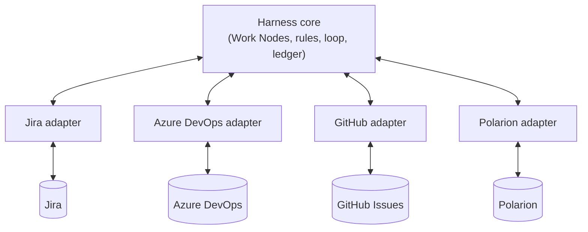
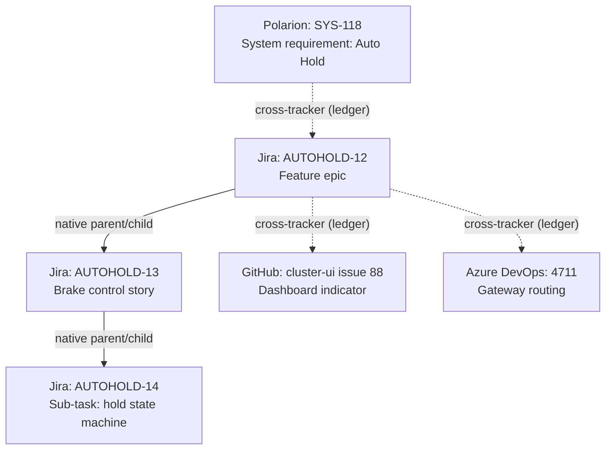

# Agent Harness OS — Connecting to Trackers (Jira, Azure DevOps, GitHub, Polarion…)

> Part of the concept series. Start with [00-overview](00-overview.md) for core ideas and glossary.
> Examples, tables and YAML here are **illustrations**, not final formats. Tool capabilities change
> between versions and editions, so always check the real setup.

## The problem

Work Nodes ([doc 02](02-recursive-v-model.md)) need to show up where people already work: their
tracker or board. But:
- different teams use **different trackers** (Jira, Azure DevOps, GitHub Issues, GitLab, Linear, Polarion…),
- one big system may use **several at once** (requirements in Polarion, features in Jira, small tasks
  as GitHub issues next to the code),
- each tracker supports different things (how deep the hierarchy goes, custom fields, webhooks…).

## The idea in four sentences

1. The harness core only knows **Work Nodes**, never "Jira issues" or "GitHub issues".
2. An **adapter** per tracker translates between the two, just like a printer driver.
3. Every piece of information has **one official owner**. Anything shown elsewhere is a **copy that can be
   regenerated** at any time.
4. A node tree may **span several trackers**. The harness holds the "glue" between them.



## 1. Who owns what?

This is the most important table in this doc. The guiding rule:

> **Trackers own what humans write. The harness owns what machines produce and anything that
> connects across tools.**

| Information | Official owner | Shown elsewhere as a copy? |
|---|---|---|
| Title, description, acceptance criteria | **Tracker** (humans edit them there) | — |
| Which rules apply (profile), where the work happens (target) | **Tracker** (field or label) | — |
| Parent/child links **within one tracker** | **Tracker** (its native hierarchy) | — |
| Parent/child links **across trackers** | **Harness ledger** | Yes: as a link or comment in both trackers |
| The node's permanent ID | **Harness** | Yes: stored on the tracker item for lookup |
| Detailed progress (Building, Checking, flags) | **Harness** | Yes: as a simple status in the tracker (§5) |
| Evidence (test results, reviews), spec fingerprint | **Harness ledger** | Yes: a summary or link in the tracker |

So when you look at a Jira issue and see "Child: github.com/acme/cluster-ui#88", that line is a
**copy**. If it's wrong or deleted, the harness simply writes it again from the ledger.

### Why the harness owns cross-tracker links
No tracker can see the other tool, so neither side can be trusted to keep the link correct. A link stored
in a tracker field can also be edited, or broken, by anyone. The ledger is the one place that sees both
ends and is protected.

### Why we don't copy the children list into each ticket
Within one tracker, the tracker already stores parent/child. Its UI shows it both ways (up and down).
Storing it again in a custom field would create two versions that eventually disagree.

## 2. Identity: three kinds of "ID"

A node needs to stay the same node even if its ticket is moved, renamed or re-keyed. So we separate:

| Kind | Example | Changes? |
|---|---|---|
| **Harness ID**: the node's permanent identity | `wn-7f3a` | Never |
| **Location**: where the item lives right now | `jira.corp / issue 10234` | When the item is moved to another project or tool |
| **Display key**: what humans see | `AUTOHOLD-12` | When a Jira issue moves to another project |

The ledger maps *Harness ID → current location(s)*. When a ticket moves, only the location is updated.
The node, its history and its evidence stay intact.

## 3. Adapters: what every tracker translator must do

Every adapter offers the same small set of operations. The core never needs to know which tool it's
talking to.

| Operation | Plain meaning |
|---|---|
| **Read** an item | Get its title, description, acceptance criteria, profile… |
| **List children / find parent** | Follow the tracker's own hierarchy |
| **Create a child** | Make a new item under a parent (safe to retry, see §6) |
| **Link** two items | Add a "depends on"/"implements"/… link, or a link to an outside URL |
| **Update** spec fields | Write intent, acceptance, profile |
| **Show status** | Move the item to the matching simple status (§5) |
| **Watch for changes** | Get notified (webhook) or check regularly (polling) |
| **Translate** | Turn the tool's own format into the standard Work Node shape |

**Adapters never decide anything.** Every write goes through the policy check first.

### Capabilities: ask, don't assume
Each tracker setup is different: edition, plan, version, admin configuration. So each adapter
**discovers and reports** what this particular installation can do:

```yaml
# illustration only
tracker: jira.corp
hierarchy_levels: 3            # e.g. Epic > Story > Sub-task in a default setup
custom_fields: yes
typed_links: yes
change_notifications: webhook
baselines: no                  # can it freeze a reviewed version of requirements?
```

### When a tracker lacks something: fallbacks
| Missing | Fallback | Downside |
|---|---|---|
| Hierarchy too shallow | Use a custom link type ("breaks down into") for deeper levels | Pick **one** method per tracker and stick to it |
| No custom fields | A small, clearly marked YAML block at the end of the description | Humans can accidentally break it, so validate on every change |
| No webhooks | Check for changes regularly | Slower; uses API quota |
| No baselines | The harness saves a snapshot of the approved specs in the ledger | The snapshot lives outside the tool. Allowed only if the rules permit it. |

Fallbacks are chosen **once per tracker installation**, never ad hoc per ticket.

## 4. One tree, several trackers

A realistic automotive setup:



- **Solid arrows:** stored by the tracker itself.
- **Dotted arrows:** stored in the harness ledger, and *shown* in both trackers as links for convenience.

### Where does a new child go?
When work is broken down, a central **routing table** decides which tracker gets each new item. Usually
it follows the code: small tasks go next to the repo where they'll be built.

```yaml
# illustration only
routing:
  - { when: { level: system },           put_in: polarion.corp/CHASSIS }
  - { when: { level: feature },          put_in: jira.corp/AUTOHOLD }
  - { when: { target: brake-ctrl },      put_in: jira.corp/BRAKE }
  - { when: { target: cluster-ui },      put_in: github.com/acme/cluster-ui }
  - { when: { target: gateway-cfg },     put_in: ado.corp/Gateway }
  - { when: { level: unit },             put_in: same-as-parent }
```

### Rules can require tracker features
A profile can say which tracker features it needs. For example, `safety-critical` might require typed
links and baselines. If routing would place such a node in a tracker without them, the harness either
re-routes it (e.g. to Polarion), uses an allowed fallback, or escalates.

## 5. Showing progress in the tracker

The harness tracks detailed phases and flags ([doc 02 §6](02-recursive-v-model.md)). Trackers show a
**simplified** version people recognise:

| Harness phase / flag | Jira (typical) | Azure DevOps (typical) | GitHub Issues |
|---|---|---|---|
| Draft, Specified, Split, Ready | To Do | New / Approved | open |
| Building, Checking, Integrating | In Progress | Active | open + label |
| flag: `escalated` / `blocked` | Blocked / flagged | tag | label |
| flag: `stale` | Reopened | Active + tag | reopened + label |
| Proven | In Review / Done* | Resolved | open + label |
| Closed | Done | Closed | closed |
| Cancelled / Superseded | Won't Do | Removed | closed (not planned) |

*Mapping is configured per tracker, because every company customises its workflows.

**Only the harness changes the status** of items it manages. If a human changes it (e.g. closes a ticket
by hand), that is treated as a **signal to check**, not blindly accepted. For example, "closed by a human"
might mean "cancel this node". The policy decides.

Two exceptions:
- Tickets the harness hasn't **adopted** yet are not managed, so people can do anything with them.
- Dedicated **request** labels, columns or comment commands (e.g. `harness:breakdown`) are how people
  deliberately start, pause or stop work. They are covered in [doc 05](05-starting-and-steering-work.md).

## 6. Noticing changes, and creating items safely

### Noticing spec changes
When a ticket changes, the adapter turns its content into a **standard plain-text form**. This matters
because Jira, Azure DevOps and GitHub store formatting differently, and a bold word shouldn't count as a
spec change. The harness then computes a **fingerprint** of only the spec fields (intent, acceptance,
profile, target, interfaces).

- **Fingerprint unchanged** (someone just commented or reassigned it) → nothing happens.
- **Fingerprint changed** → old evidence becomes `stale`, dependants are re-checked, and the change
  (who/when/what) is logged.
- **Spec changed by someone not allowed to** (e.g. the implementer agent editing its own acceptance
  criteria) → blocked or escalated. Trackers rarely have per-field permissions, so the harness enforces this.

What happens *next*, when agents are already working on the changed item (pausing, re-planning,
Epic vs. child changes), is described in [doc 02 §9](02-recursive-v-model.md).

### Creating items without duplicates
Creating a subtree across several trackers is several separate steps, and any of them can fail. To avoid
duplicates or half-built trees:
1. **Write down the plan first.** The ledger records "these children will be created", each with its
   permanent harness ID.
2. **Create items one by one.** After each one, record its location in the ledger.
3. **Retries check first.** Before creating, look in the ledger (and the tracker) for an item with that
   harness ID. Most trackers can't strictly guarantee uniqueness, so the harness also **scans for
   duplicates** afterwards and merges or flags them.
4. **Then add the links** and the convenience copies.
5. A subtree only counts as **complete** when every item and link checks out. Persistent failure
   escalates. There is never a silent half-tree.

## 7. Example: mapping to Jira

One possible setup:

| Work Node concept | In Jira |
|---|---|
| Breakdown (first 3 levels in a default setup) | Native hierarchy: Epic → Story → Sub-task |
| Breakdown deeper than that | Custom link type "breaks down into" (or a configured custom hierarchy level on plans that support it) |
| Intent | Summary + description |
| Acceptance criteria | A dedicated field, one `AC-n:` per line, so each criterion has a stable ID that tests can refer to |
| Profile, level | Custom select fields |
| Target | Component field |
| Interfaces | Links to "Interface" issues |
| Official requirement | Remote link to the Polarion/DOORS item |
| Harness ID | Issue property (API metadata). **Not secret, and editable by issue editors**, so the ledger stays the real owner |
| Cross-tracker parent/children | Remote links (copies of the ledger) |
| Status | Workflow transitions per §5 |
| Change notification | Webhooks |
| Requirement baselines | Not built in → keep baselined levels in Polarion/codebeamer, or use ledger snapshots |

Other trackers follow the same pattern:
- **Azure DevOps:** deep parent/child links, area paths for the target, rich custom fields.
- **GitHub Issues:** sub-issues for the hierarchy (within GitHub's depth/size limits), issue types and project fields
  for metadata, labels as fallback.
- **GitLab:** epics/issues/tasks, scoped labels (e.g. `profile::safety-critical`).
- **Polarion/codebeamer:** strong traceability and baselines, the natural home for the top levels in safety work.

## 8. Security

- **Least privilege:** each tracker connection gets only the permissions it needs, and credentials are held centrally.
- **Role-based write access:** only decomposers (and humans) may change acceptance criteria. Implementers may
  comment and report progress, nothing more.
- **Everything is logged:** every write records who (role + agent), what, and which policy allowed it.
- **Ticket text is not instructions.** Descriptions and comments can be written by anyone and may contain
  hidden instructions aimed at AI agents (*prompt injection*). Defences:
  - an agent's **instructions and permissions come only from the harness** (its role, its rules, the node's
    approved spec), never from ticket text;
  - ticket content is passed to agents **clearly marked as untrusted data**, with its source;
  - each role sees **only the fields it needs** (e.g. a verifier doesn't need comment threads);
  - nothing in a ticket can **change an agent's permissions or rules**. That only happens through central policy.

## 9. Open questions
- If a human re-parents an issue in Jira, should the harness accept it, re-validate it, or always escalate?
- What happens when a team **moves to another tracker** mid-project? Harness IDs survive, but tracker history doesn't.
- How should **many-to-many** relations (one requirement realised by items in several trackers) be shown to humans
  in each tool?
- Should the top levels (system/feature) be forced into a tracker with baselines for safety-critical work, or
  are ledger snapshots acceptable?
