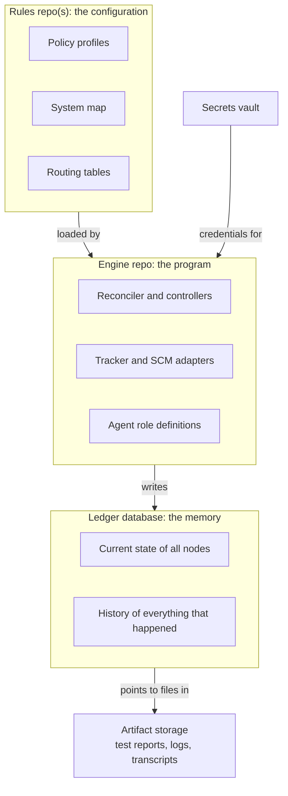
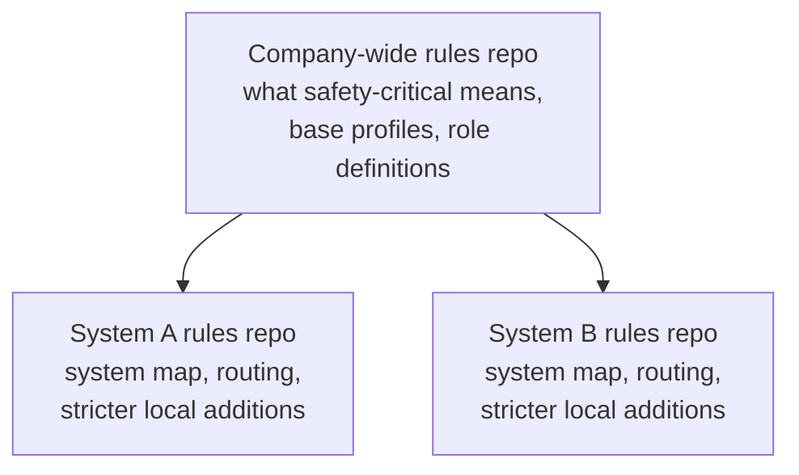
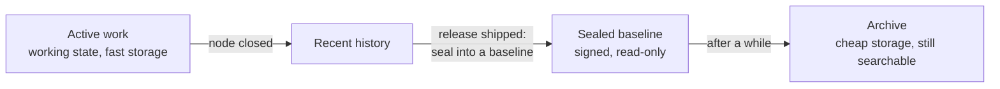
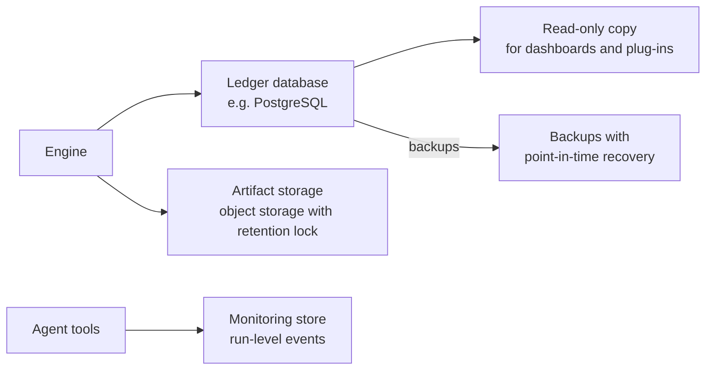

# Where the harness lives: engine, rules and memory

> Part of the Agent Harness OS concept docs. New here? Start with [00-overview](00-overview.md).
> Examples, tables and YAML are **illustrations**, not final formats.

## The problem

Docs 01–03 describe *what* the harness does. This doc answers a practical question:
**where does the harness itself live?** Is it a repo? A server? A database? And what happens to all
the records it keeps after years of work on a large system?

## The idea in four sentences

The harness is not one thing but **three**: an **engine** (the program), its **rules** (configuration),
and its **memory** (the ledger). Each changes at a different speed, is edited by different people, and needs
a different kind of storage, so each gets a **different home**. The engine and the rules are kept in
repos. The memory is kept in a database, because git is the wrong tool for something that many agents
write to every second.

---

## 1. Three parts, three homes

The easiest way to picture it is to think of a computer's operating system, which also has three parts:

| In a computer | In the harness | What it is | Home |
|---|---|---|---|
| The **program files** (kernel) | **Engine** | The reconciler loop, the controllers, the tracker adapters, the agent role definitions | Its **own repo**, released like a product |
| The **settings** (`/etc` on Linux) | **Rules** (configuration) | Policy profiles, the system map, routing tables, which trackers and repos to connect to | **Separate, locked-down repo(s)** |
| The **data and logs** (`/var`) | **Memory** (ledger) | Every node's status, claims, spec versions, evidence links, history | A **database**, not git |
| The **password manager** | Secrets | Credentials for Jira, GitHub, CI… | A **secrets vault** |

### Why not just put everything in one repo?

Because the three parts differ in ways that matter:

| | Engine | Rules | Memory |
|---|---|---|---|
| **How often it changes** | Every few weeks (new release) | Occasionally (policy decision) | Constantly, many times per second |
| **Who changes it** | Harness developers | Process, safety and architecture owners | The harness itself, automatically |
| **May agents change it?** | Only via normal reviewed development | **Propose only**; humans approve | Only through the harness, never directly |
| **What it needs most** | Testing and versioning | Review and history | Speed, locking, tamper-evidence |

Mixing them would mean, for example, that a routine rule change triggers an engine release, or that
every agent action becomes a git commit.

---

## 2. The engine: a product like any other

The engine is software, so it's developed like software: in **its own repo**, with tests and **versioned
releases**.

- **One engine, many systems.** The same engine runs for a tiny app and for a car platform. What differs
  is the rules it loads, not the engine.
- **Systems pick their engine version.** A safety-critical system doesn't automatically get every new
  engine release. It upgrades deliberately, the same way it would upgrade a compiler. This matters because
  the engine is a tool that affects the product, and safety standards ask for tools to be qualified.

---

## 3. The rules: "policy as code"

The rules are plain text files (YAML, for example) kept in a repo. This is called **policy as code**.
Why a repo, when the memory isn't one? Because rules need exactly what repos are good at:
- **Review:** every change is a pull request that the right people approve.
- **History:** you can always see who changed which rule, when, and why. This doubles as the audit trail
  for rule changes.
- **Rollback:** a bad rule change can be undone.

### Two layers: company-wide and per system

Rules come in two layers, following the golden rule that **lower levels may only make rules stricter**:

- The **company-wide** layer defines the shared meaning of things, e.g. what checks `safety-critical` always requires.
- The **per-system** layer holds what is specific to one system: its system map (components and approved
  interfaces, doc 01), its routing table (which tracker gets which work, doc 03), and any extra rules.
  It can add rules but never remove company-wide ones.

### Agents and the rules

Agents may **suggest** a rule change, for example "add the new repo to the system map". A human always
approves it. If agents could change the rules freely, they could weaken the checks on their own work.

---

## 4. The memory: the ledger

The ledger is the harness's memory. It records:
- the **current state** of every Work Node (phase, flags, who has claimed it),
- **which spec version** each piece of work was built against (doc 02 §9),
- **links to evidence**: test reports, reviews, coverage,
- the **full history** of everything that happened, and who or what did it.

### Why not keep it in git?

Git is designed for people editing files and merging occasionally. The ledger is the opposite:
- **Many writers at once.** Dozens of agents update it every second. In git, that means constant merge conflicts.
- **Locking is needed.** When an agent claims a node, no other agent may claim it at the same moment.
  A database does this reliably; git can't.
- **Tamper-evidence.** Each record carries a checksum linked to the previous one (a *hash chain*). If anyone
  changes an old record, the chain breaks and it's noticed.

The ledger can still **export** snapshots to git or to a requirements tool, for example at each release,
so auditors can read it with familiar tools.

---

## 5. One ledger per system

**Usually, yes: one ledger per system.**

- A system is a natural boundary. Its Work Nodes, links, claims and integration nodes all belong together.
- Two systems normally only meet at their outer edges (level-3 interfaces, doc 01), which agents can't
  change anyway. So they rarely share work. When they need to refer to each other, a reference by ID
  into the other ledger is enough.
- **Physically**, this can still be **one shared database** with a separate section (partition) per system.
  That makes company-wide reports easy without mixing the systems' data.

---

## 6. Won't it get huge?

After years and hundreds of Epics, a large system produces a lot of records. Three design choices keep this
manageable.

### a) The ledger stores facts, not files

Big files never go into the ledger. Test reports, coverage reports, logs and agent transcripts go to
**artifact storage**: cheap bulk file storage, like a cloud storage bucket. The ledger keeps only:
- a **link** to the file, and
- its **fingerprint** (checksum), which proves the file hasn't been changed since.

So each ledger record is tiny. Millions of them are routine for an ordinary database. Most of the bulk is in
artifact storage, and agent transcripts are usually the largest part.

### b) "Now" is kept separate from "history"

Think of a **bank account**:
- The **balance** is small and always up to date. You check it all the time.
- The **list of transactions** grows forever, but you rarely look at old ones. The balance can always be
  recalculated from the list.

The ledger works the same way:

| | Like… | Contains | Size | Who reads it |
|---|---|---|---|---|
| **Working state** | The balance | Open nodes, current claims, current spec versions, flags | Small; only active work | The reconciler, constantly |
| **History** | The transactions | Every event that ever happened | Grows forever | Auditors and people investigating, occasionally |

The reconciler only ever looks at the working state, so it stays fast no matter how much history there is.
(The technical name for this pattern is **event sourcing**.)

### c) Seal and archive at each release

When a release ships, everything that belongs to it is **sealed**:
- the Closed nodes, their spec versions and their evidence are frozen into a **baseline**,
- the baseline is signed and fingerprinted so it can't be altered later,
- it then moves to **cheaper, slower storage**. It's still searchable for audits, but out of the way.

Because **Closed is final** (doc 02 §6), sealed history never needs to be rewritten. A later change creates
a *new* node that links back to the old one.

### Keeping it long enough: retention

In automotive, evidence must often be kept for **a very long time**, commonly 15 years or more, depending
on company and customer (OEM) rules. So old data is **moved to cheaper storage, not deleted**.

Different kinds of data can have different **retention** periods (how long they must be kept):
- **Decisions and evidence:** kept for the full period.
- **Agent transcripts:** might be kept for a shorter time, if company policy allows. They are useful for
  improving agents, but usually aren't formal evidence.

---

## 7. How it's typically deployed

Because the ledger is so central, it's tempting to think it needs a special, high-performance database.
It doesn't. What it needs most is to be **correct, durable and tamper-evident**, not extremely fast.

### How much load is there really?

The trick is to **not** put everything into the ledger. There are three kinds of data, and only one of them
goes there:

| Kind of data | How much (e.g. 50 agents working at once) | Where it goes |
|---|---|---|
| **Work level:** phase changes, claims, evidence links, gate decisions | Little: tens of writes per second at the busiest | **Ledger** |
| **Run level:** every tool call and step inside each agent session | A lot: thousands of events per second | A **separate monitoring store** (see doc 06) |
| **Files:** test reports, logs, transcripts | Few, but big | **Artifact storage** (§6a) |

With the run-level flood kept out, what's left is an everyday workload for any ordinary database.

### A typical setup

| Part | Typical choice | Why |
|---|---|---|
| **Ledger** | An ordinary relational database, typically **PostgreSQL**. Either managed by a cloud provider (Azure, AWS, Google) or run on the company's own servers | Reliable **transactions**, needed so two agents can't claim the same node. Flexible JSON fields for node specs. Can walk trees with a single query. Can keep systems apart with access rules. |
| **Tamper-evidence** | A **hash chain** (§4) built by the harness, plus a table that only allows adding, never changing. Alternatively, databases with built-in ledger features (e.g. Azure SQL ledger tables, or the open-source immudb) | Proves that history wasn't changed afterwards. (Amazon's dedicated ledger database, QLDB, has been discontinued, which shows the risk of depending on a niche product.) |
| **Event stream** for live views (doc 06) | Start with the database's own notification feature. Add a message broker (Kafka, NATS, Azure Event Hubs) only when many plug-ins need it | Fewer moving parts at the start |
| **Artifact storage** | Object storage (S3, Azure Blob, or MinIO on own servers) with a **retention lock** (files can't be deleted or changed before their retention period ends) | Cheap for large files; evidence is protected |
| **Run-level events** | A monitoring back end that supports OpenTelemetry | Built for large volumes; usually kept for a shorter time |
| **Simple app** | A **SQLite file** and a local folder | Nothing to install or run |

**What about a graph database?** Not needed. Trees and typed links (doc 02 §2) fit well into ordinary
tables. A graph database might become interesting later, for heavy analysis across many systems, but it
isn't a good starting point.

### Keeping it fast

- The reconciler only reads the **small working state** (§6b), which is indexed and quick to search.
- The growing history is **split by system and by time**, so old data doesn't slow down new data.
- Dashboards and plug-ins read from a **read-only copy** of the database, so people looking at progress
  never slow down the agents doing the work.

### Cloud, or our own servers?

Both work, and the design doesn't depend on it: PostgreSQL behaves the same either way.

In automotive, it's often the **company's own cloud account or its own servers**, rather than a shared
service run by someone else. Typical reasons:
- code and specifications are valuable intellectual property,
- customer (OEM) contracts and security assessments such as **TISAX** set rules on where data may be,
- some data must stay in certain countries.

### What if the ledger is unavailable?

The harness **stops safely**: agents pause, and nothing is lost, because nothing can be claimed or recorded
without the ledger. That makes **high availability** (a standby copy ready to take over) nice to have, but
not critical. What **is** critical are **backups with point-in-time recovery** (restore to any moment, not
just last night), because the ledger holds the audit evidence.

---

## 8. From tiny app to large system

Everything above can **shrink down** for a simple app:

| | Simple app | Large system |
|---|---|---|
| Engine | Installed as a tool (like a command-line app) | A shared service, version chosen per system |
| Rules | A small config file, or just the built-in `simple-app` defaults | Company-wide rules repo + per-system rules repo |
| Ledger | A local database file (e.g. SQLite) | A shared database, one partition per system |
| Artifact storage | A local folder | Cloud storage with retention rules |
| Archiving | Not needed | Seal and archive per release |

One exception to "rules live outside the repo": for the `simple-app` profile, keeping the config file
**inside the app repo** is acceptable, as long as it's protected by CODEOWNERS. For anything stricter,
it isn't, because the agent would then be working right next to its own rules.

### The two layers on a single machine

Even a harness running as an app on one developer's machine keeps the two layers from §3:

- The **harness's own settings** play the part of the company-wide layer. They live outside the repo,
  where agents can't reach them, and set the outer limits, e.g. "agents never push" or "land only on a
  local integration branch".
- The **repo's config** plays the part of the per-system layer. It can choose within those limits and
  make them stricter, never looser. The harness reads it **only from `main`**, never from a leaf's branch,
  so an agent can't change the rules for its own work.

The effective value of each setting is shown together with **where it came from**, so nobody has to guess
why the harness behaves the way it does.

### Same engine, different storage

The engine talks to its storage through a **narrow interface**: append events if the version is still the
expected one, and read them back (the ledger), plus put and get files (artifacts). A local file, SQLite or
PostgreSQL can sit behind it, so growing from one machine to a shared service is a change of configuration,
not of design. Wherever it lives, the harness's own state stays **out of the product repo's working copy**:
there, it would end up in commits by accident, and agents could edit it.

---

## 9. When agents help build the harness itself

Sooner or later, agents will be used to improve the harness. That's fine, but it's like a surgeon operating
on themselves, so extra care is needed:
- **Never run on your own unfinished changes.** Agents changing the engine work under the *released*
  engine, not the version they are editing.
- **Engine and rule changes always need human approval**, even under the lightest profile.
- **Builder ≠ checker applies here too.** The agent that changes the harness doesn't verify it.

---

## 10. How this connects to the other docs

| Topic | Where |
|---|---|
| What lives in each product repo (README, AGENTS.md, manifest) | [doc 01](01-repo-local-files.md) |
| System map and interface levels | [doc 01](01-repo-local-files.md) (content), this doc (where it's stored) |
| Work Nodes, lifecycle, spec versions, reconciler | [doc 02](02-recursive-v-model.md) |
| Routing tables and tracker connections | [doc 03](03-tracker-adapters.md) (content), this doc (where it's stored) |
| Event stream, monitoring store, read-only views | [doc 06](06-seeing-what-the-harness-is-doing.md) |

## 11. Open questions
- Should each system run its own copy of the engine, or should one shared service serve all systems?
- Who owns the company-wide rules repo: a process group, the safety team, or a joint board?
- How long must agent transcripts be kept, and are they ever needed as evidence?
- Does the engine need formal **tool qualification** (ISO 26262 Part 8) when used for safety-relevant work,
  and what would that involve?
- When exactly is a baseline sealed: at every release, or at defined milestones?
- Cloud or own servers: which customer (OEM) or security rules decide this for our systems?
- Is a hash chain built by the harness enough as tamper-evidence, or is a database with built-in ledger features required?
