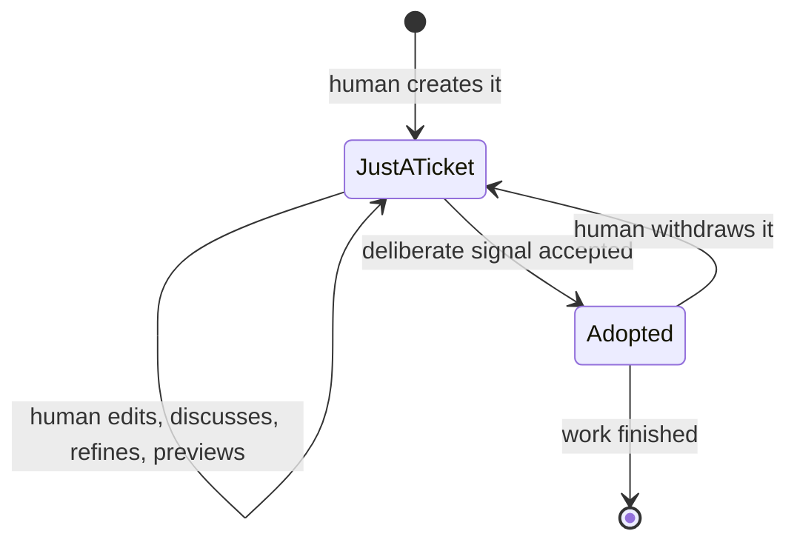
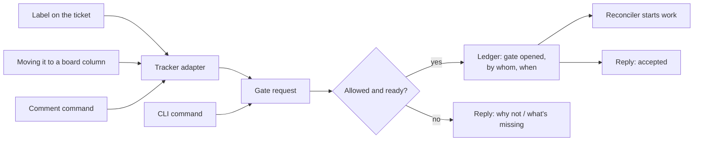
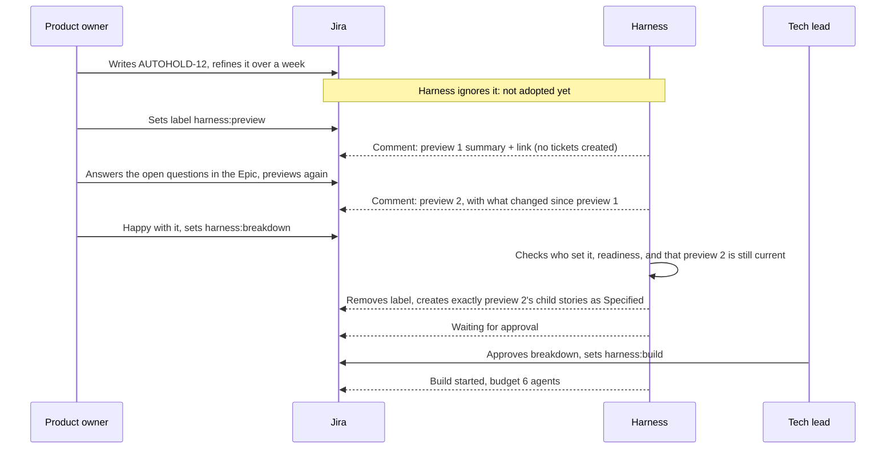

# Starting and steering work

> Part of the Agent Harness OS concept docs. New here? Start with [00-overview](00-overview.md).
> Examples, labels, commands and YAML are **illustrations**, not final formats.

## The problem

Docs 01–04 describe what the harness does once it's working. But how does work actually **start**?
Someone has written an Epic or a story. When should agents begin breaking it down? When should they start
writing code? And how does a person stop them again?

The tricky part is that **people work iteratively**. A ticket is created half-finished, refined over days,
discussed, rewritten. Just because a ticket *exists* doesn't mean it's ready for agents.

## The idea in four sentences

The harness never starts work on a human's ticket by itself: a person must **deliberately signal** it,
with a label, a board column, a comment command or the CLI. Each signal opens a **gate**, i.e. gives
permission for one kind of work (breaking down, or building) on that ticket and everything under it.
Before accepting, the harness runs a **readiness check** and replies either "started" or "here's what's
missing". Tickets the agents create themselves are different: they inherit the permission from the signal
that created them, so no one has to signal each one again.

---

## 1. Two separate questions

It's easy to mix these up, so it helps to keep them apart:

| Question | Example answers | Who decides |
|---|---|---|
| **When** may the harness start? | "Now, I'm happy with this Epic." | Always a **person**, deliberately (for human tickets) |
| **How** does it work once started? | On its own / asking when unsure / step by step with me | The person who started it, within what the profile allows |

A ticket can be broken down fully autonomously, but only **after** someone deliberately said "go".

---

## 2. The basic rule: human tickets never start by themselves

Until someone signals it, a human's ticket is **just a ticket**. The harness doesn't touch it, doesn't
comment on it, doesn't react to its edits. People can create, rewrite and discuss it as much as they like.

The signal makes the harness **adopt** the ticket: from that moment it becomes a Work Node (doc 02), the
harness starts tracking it, and the rules from docs 02–03 apply (e.g. "only the harness changes the status",
and edits now count as spec changes, see doc 02 §9).

One exception: a **Preview** signal (§3) does **not** adopt the ticket. It's a one-off look, and the
ticket stays in the people's hands.



Why this matters:
- **No surprises.** Agents never act on a half-written idea.
- **Less noise.** The harness doesn't spam half-finished tickets with questions.
- **Clear responsibility.** There's always a named person who said "this is ready", which the ledger
  records. Auditors like that.

---

## 3. Gates: what a signal gives permission for

Each signal opens one **gate** on one ticket. The gate covers that ticket **and everything below it**.

| Gate | Gives permission to… | Typical signal |
|---|---|---|
| **Preview** | Show a proposed breakdown, without creating any child tickets (a dry run) | `harness:preview` |
| **Breakdown** | Split the ticket into child tickets | `harness:breakdown` |
| **Build** | Implement and check the leaves below it | `harness:build` |
| **Go** | Breakdown and Build in one signal: break down, implement and check without stopping in between | `harness:go` |
| **Pause** | Finish the current step, then start nothing new (flag `paused`) | `harness:pause` |
| **Resume** | Continue after a pause | `harness:resume` |
| **Withdraw** | Stop and hand the ticket back to people to keep refining | `harness:withdraw` |

**Preview** fits iterative work well: you can "try" a breakdown, look at it, refine your Epic, and try again,
without any tickets being created. How that works in practice is described next.

**Go** is the label form of `harness go` (§9), for simple, low-risk work. It opens both gates at once, so the
readiness checks for Breakdown *and* Build run up front. Nobody reviews the breakdown before building starts.

### Which signals are available

Not every signal suits every project, so the **profile** decides which ones are offered, layered like any
other rule ([doc 04 §3](04-where-the-harness-lives.md)): the company layer sets the most a profile may offer,
and a repo may only switch signals **off**. For example, `simple-app` offers them all; a safety profile
leaves out **Go**, because a person must approve the breakdown before anything is built. A signal that isn't
offered is rejected with a reply listing the ones that are.

### What a preview looks like, and what you do with it

"Creates nothing" means **no child tickets**. The proposal itself has to be shown somewhere. It comes in
two layers, so the ticket stays readable:

**1. A short summary comment on the ticket**, enough to judge it at a glance:

```text
Harness preview 2 of AUTOHOLD-12 (based on the Epic as edited 27 Oct, 16:40)

Proposed breakdown: 3 stories, 2 sub-tasks, 2 integration checks
  ├─ Brake control logic          (brake-ctrl)
  │   ├─ Hold state machine
  │   └─ Release on accelerator
  ├─ Dashboard indicator          (cluster-ui)
  └─ Gateway signal routing       (gateway-cfg)

Changed since preview 1: + Gateway signal routing (new), Dashboard merged into one story

Needs your input (2):
  ? AC-2: what counts as "pressing" the accelerator? (assumed: pedal > 5%)
  ? Should Auto Hold work on slopes over 20%? (assumed: no)

Warnings (1):
  ! gateway-cfg has no simulation test in its manifest, so it can't be proven at this profile

Full proposal: <link>
```

**2. The full proposal**, as a document behind the link (and via `harness preview show AUTOHOLD-12`).
For each proposed child it shows:
- title and one-line intent,
- draft acceptance criteria,
- target repo, and the profile that would apply,
- proposed interfaces between the children, and the integration checks,
- **assumptions** the agent had to make, and **open questions**.

The full proposal is stored by the harness (ledger + artifact storage, doc 04), **not** in the tracker,
so it doesn't clutter the ticket.

**The most valuable part is usually not the tree, but the questions, assumptions and warnings.** They show
exactly where the Epic is still vague. That's what people use to refine it.

**What you can do with a preview:**

| You want to… | You do… | What happens |
|---|---|---|
| Improve the Epic | Edit the ticket, then preview again | A new numbered preview, **with what changed since the last one** |
| Steer the next attempt | Comment `/harness preview --note "keep dashboard as one story"` | The note is used as guidance for the next preview |
| Accept it as it is | Set the label `harness:breakdown` (uses the **latest** preview), or comment `/harness breakdown --from-preview 2` to pick a specific one | Exactly that proposal is created, **not a fresh one** |
| Drop it | Do nothing | Nothing happens; the ticket stays yours |

**Why "accept exactly this preview" matters:** AI agents don't give the same answer twice. If "breakdown"
simply ran again, the tickets created could differ from what you reviewed. Accepting a preview
guarantees *what you saw is what you get*. (If there is no preview, `harness:breakdown` creates a fresh breakdown.)

**Previews go out of date.** Each preview records the version of the Epic it was based on (its fingerprint,
see doc 02 §9). If the Epic has been edited since, accepting that preview is refused: *"The Epic changed
after preview 2. Preview again, or confirm that preview 2 still fits."*

**In the CLI**, a preview can be **interactive**: the tree is shown, and you can adjust it on the spot
(merge, split, rename children) before accepting it.

**Pause and Withdraw matter as much as starting.** Every channel that can start work must also be able to
stop it.

### The profile decides who may open which gate

```yaml
# illustration only
profiles:
  simple-app:
    breakdown: { who: team-member }
    build:     { who: team-member, may_combine_with_breakdown: true }   # one "go" for both
  internal-product:
    breakdown: { who: team-member }
    build:     { who: team-member, needs: breakdown-reviewed }
  safety-critical:
    breakdown: { who: [product-owner, system-architect] }
    build:     { who: tech-lead, needs: breakdown-approved-by-human }
```

Even for `simple-app` the start is deliberate. The difference is only that **one** signal may cover both
breakdown and build.

---

## 4. Channels: many ways to signal, one mechanism

People should be able to signal from wherever they already work. All channels lead to the same thing:
a **gate request**, which the harness checks and records.



| Channel | Example | Good for | Watch out for |
|---|---|---|---|
| **Label** | `harness:breakdown` | Visible, easy, works in almost every tracker | Not secure on its own (see below) |
| **Board column / workflow step** | Move to "Ready for breakdown" | Natural on a board; Jira can restrict who may move it | Must be a dedicated "request" column, separate from the statuses the harness manages |
| **Comment command** | `/harness breakdown --mode guided --depth 1` | Can carry options; leaves a visible record | Parsed strictly as a command, never handed to an AI as free text |
| **CLI** | `harness breakdown AUTOHOLD-12 --mode interactive` | Developers, simple apps without a tracker, interactive sessions | Others can't see it, so the harness posts a note back to the ticket |

### Rules that make labels (and columns) safe

1. **Check who set it.** Labels can be set by anyone who can edit the ticket. The harness reads the ticket's
   history to find **who** set it, and checks that this person may open that gate (§3).
2. **Ignore signals from agents.** Labels set by an agent, or by the harness's own account, are ignored.
   Otherwise an agent could trigger itself.
3. **A signal is a one-time request, not a status.** The harness reads the label, **removes it**, and answers
   with a comment and the matching status. If labels stayed, they would drift out of sync with the real state.
4. **Use a prefix** like `harness:` so harness labels never clash with a team's own labels.
5. **Always reply.** "Breakdown started by Jane." or "Not started: see below." Silence makes people try again.
6. **Fallbacks per tracker.** If a tracker has no labels, use a column or a comment command instead
   (doc 03 §3).

---

## 5. The readiness check: "is this ticket fit for agents?"

When a gate is requested, the harness first checks the ticket against a **Definition of Ready**: a list
of things that must be true before agents can do useful work. If something is missing, it replies with
exactly what, and does nothing else.

| For Breakdown | For Build |
|---|---|
| The intent is clear: what and why | The breakdown is done and, if required, approved |
| There is at least a rough idea of "done" (acceptance criteria) | Every leaf has testable acceptance criteria |
| A profile can be determined | Interfaces between leaves are agreed |
| It links to the official requirement (if the profile demands it) | Every leaf passes the leaf check (doc 02 §4) |
| | Every target's manifest offers the checks the profile requires (doc 01) |
| | A **budget** is set: max parallel agents, cost, time |

Example reply:
> **Not started.** AUTOHOLD-12 has no acceptance criteria yet. Add at least one "done when…" statement,
> then set `harness:breakdown` again, or use `harness:breakdown --mode interactive` to work them out together.

This turns the readiness check into **helpful feedback** for people who are still iterating, rather than
just a refusal.

---

## 6. How breakdown runs once started: three modes

Once the Breakdown gate is open, the person chooses **how** it runs:

| Mode | What the agent does | Good for |
|---|---|---|
| **Autonomous** | Breaks down on its own; the result is a proposal | Clear specs, low risk |
| **Guided** *(suggested default)* | Works on its own, but **asks** when something is unclear | Most work |
| **Interactive** | Works through it **with** you, step by step | Vague Epics, new areas, learning how the harness thinks |

**Where do the questions and answers happen?**
- **In the CLI:** quick and conversational, but only one person sees it.
- **As ticket comments:** slower, but the whole team sees them, and they remain as a record of *why* the
  breakdown looks the way it does. That's valuable for traceability.

Either way, the decisions end up written back to the ticket or ledger.

**How deep?** `--depth 1` breaks down one level and stops for review (good for strict profiles).
`--depth auto` keeps going until every branch passes the leaf check (good for simple work).

**In every mode, the result is a proposal.** Children are created as **Draft** or **Specified** (doc 02 §6).
Under strict profiles a person approves them before any of them can be built.

---

## 7. Tickets created by agents

When the decomposer splits an Epic into stories, it creates new tickets. Do *those* need a signal too?

**No: they inherit the permission from the signal that created them.** The person who opened the Breakdown
gate on the Epic already said "go" for everything below it. Asking them to signal every child again would
make the harness unusable.

But "inheriting permission" doesn't mean "ready". Agent-created tickets still have to pass checks:

| | Human-created ticket | Agent-created ticket |
|---|---|---|
| How it starts | Half-finished, refined over time | Complete in one go, as a proposal |
| Who says "go"? | A person, deliberately | Inherited from the parent's gate |
| What makes it ready? | The person's signal + readiness check | Readiness check + approval, if the profile requires it |
| If something is unclear | The person keeps refining it | The agent marks it **Draft** with **open questions**, and the `escalated` flag |

### Do agents also iterate on tickets?

Not the way people do. An agent doesn't "come back next week" to a ticket. Instead, iteration happens through
the harness's own loops:
- **Open questions:** the agent leaves a child as Draft, lists what it needs to know, and asks a person.
  When answered, the child continues automatically, with no new signal needed.
- **Pushback** (doc 02 §8): a child finds a problem and sends it back to the parent to re-plan.
- **Review:** a person reviewing the proposed breakdown asks for changes, and the decomposer revises it.

### When a person edits an agent-created ticket

That's allowed, but the ticket is already adopted, so the edit counts as a **spec change** and follows
doc 02 §9 (sort the change, find what's affected, pause or redo). If the person wants to rework it
properly, they **withdraw** it, refine it at their own pace, and signal again when ready.

---

## 8. Starting the build

Opening the Build gate on a parent means **"build every Ready leaf below this one"**. The reconciler then
schedules leaves in parallel where the links allow (doc 02 §7), within the budget.

Two choices to configure per profile:
- **Scope:** does Build on an Epic cover everything below it, or only children that are individually marked?
  Covering everything is simpler; marking individually gives more control in strict projects.
- **Budget:** how many agents may run at once, and how much time or money they may use before the harness
  pauses and asks. The budget is set when the gate is opened, and shown in the reply.

---

## 9. Two examples

### Simple app, via the CLI
```text
$ harness go wn-01 --mode autonomous
Readiness check passed. Profile: simple-app.
Breakdown: not needed, wn-01 is already a leaf.
Build started. Budget: 1 agent, 30 min.
```
One deliberate command. Everything else happens on its own.

### Car feature, via Jira



---

## 10. How this connects to the other docs

| Topic | Where |
|---|---|
| Phases (Draft, Specified, Ready…) and flags | [doc 02 §6](02-recursive-v-model.md) |
| What happens when an adopted ticket is edited | [doc 02 §9](02-recursive-v-model.md) |
| Leaf check | [doc 02 §4](02-recursive-v-model.md) |
| Manifest checks vs. profile requirements | [doc 01](01-repo-local-files.md) |
| Labels, columns and fallbacks per tracker; "only the harness changes status" | [doc 03](03-tracker-adapters.md) |
| Where the gate decisions are recorded | The ledger ([doc 04](04-where-the-harness-lives.md)) |

## 11. Open questions
- Should Build on an Epic cover everything below it by default, or only explicitly marked children?
- Who may open which gate: by role (e.g. product owner opens Breakdown, tech lead opens Build) or anyone in the team?
- How long may an agent-created Draft wait for answers before it's flagged or withdrawn?
- How many previews are kept per ticket, and for how long? Are they part of the audit trail once accepted?
- Should the harness ever *suggest* that a ticket looks ready (without starting), or stay completely silent until signalled?
