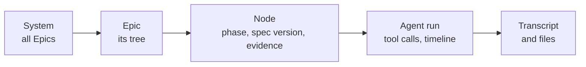
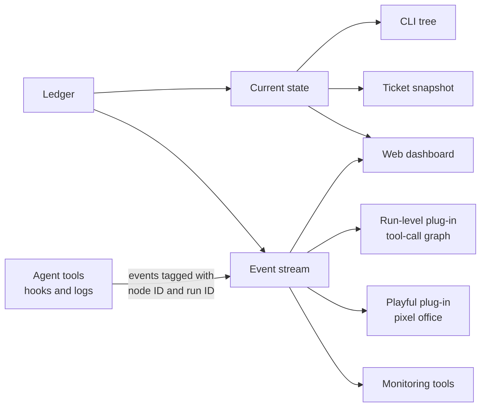
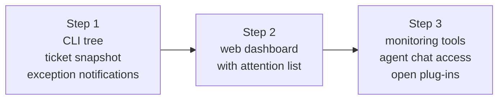

# Seeing what the harness is doing

> Part of the Agent Harness OS concept docs. New here? Start with [00-overview](00-overview.md).
> Examples, commands and formats are **illustrations**, not final designs.

## The problem

Once agents are working, people need to be able to see **what's going on**: how far along the work is,
what's happening right now, what's stuck, and above all **what needs a human**. This has to work at any
stage, from the first preview to the final release, and for anyone from a developer at a terminal to a
product owner who only ever opens Jira.

## The idea in four sentences

Everything the harness knows is in the **ledger**, so every view is simply a **read-only copy** built from
it. There are many ways to look at it (the tracker, the CLI, a snapshot diagram in the ticket, a dashboard,
chat notifications, monitoring tools) because different people need different things. Instead of locking in
one way to draw it, the harness offers **two fixed data contracts** (the current state, and a stream of
events), and any view, including **plug-ins**, is built on those. Views can only *show*; to *act*, people
use the normal signals from doc 05.

---

## 1. When does the tree exist?

The Work Node tree isn't created in one go. It **grows**, and it can change shape later:

| Stage | What exists in the ledger | What a view can show |
|---|---|---|
| Just a ticket | Nothing (not adopted yet, doc 05) | Nothing |
| Preview | A proposal only: a "ghost" tree | A dashed tree, with questions and warnings |
| Breakdown accepted | The root node plus the proposed children | Nodes marked "waiting for approval" |
| Building and checking | Real nodes, claims, agent runs, check results | Live progress per leaf |
| Integrating | Integration nodes, with the versions being tested together | Which parts are proven together |
| Proven and closed | Evidence, later sealed into a baseline (doc 04) | The finished tree and its proof |

It keeps changing after that: deeper breakdowns, pushback (doc 02 §8) and re-plans after spec changes
(doc 02 §9). So the views must be able to show a tree that is **still changing**, not a fixed plan.

---

## 2. What people actually want to know

| Question | Example | Typically asked by |
|---|---|---|
| **What needs me?** | Escalations, approvals, open questions, paused work | Everyone. **The most important one.** |
| Where are we? | The tree, the phase of each node, overall progress | Product owner, team lead |
| What's happening right now? | Which agent works on which leaf, which Ralph round | Developers |
| Why is it like this? | History, decisions, spec versions, evidence | Reviewers, auditors |
| What does it cost? | Agents running, time and money used vs. budget | Team lead, whoever pays |
| Is it healthy? | Repeated retries, no progress, flaky checks | Whoever operates the harness |

In this model **humans handle the exceptions**, so the "What needs me?" list (the **attention list**) matters
more than any pretty tree. Every view should make it impossible to miss.

---

## 3. Two levels of detail: the work, and one agent's run

There are two quite different things to look at, and it helps to keep them apart:

| Level | Shows | Comes from | Example tools |
|---|---|---|---|
| **Work level** | The Work Node tree: which work, in which phase, proven or not | The harness ledger | CLI tree, ticket snapshot, dashboard |
| **Run level** | What happens *inside* one agent session: tool calls, files touched, sub-agents, time spent | The agent tools themselves (hooks, logs) | Open-source viewers like [agent-flow](https://github.com/patoles/agent-flow) (graph of tool calls) or [pixel-agents](https://github.com/pixel-agents-hq/pixel-agents) (agents as characters in an office) |

A good set of views lets you **zoom in step by step**:



The first three steps are the work level. The last two are the run level.

---

## 4. Ways to look at it

| Option | Good for | Limits |
|---|---|---|
| **The tracker itself** (Jira hierarchy, board, timeline) | People see it where they already work; no new tool | Simplified statuses (doc 03 §5); can't show trees spread over several trackers; typed links and integration nodes are hard to see |
| **CLI** (`harness status`, `harness watch`, `harness why`) | Developers; fast; works for simple apps without a tracker | Only you see it |
| **Snapshot diagram in the ticket** (§6) | Visual, at almost no extra cost | A snapshot, not live; gets crowded for big trees |
| **Web dashboard** | The full picture: tree, live progress, attention list, zooming in to evidence | Has to be built; needs access control |
| **Notifications** (Teams, Slack, e-mail digest) | Brings exceptions **to** people instead of making them look | Gets noisy fast, so send only exceptions and gate events |
| **Monitoring tools** (OpenTelemetry → Grafana and similar) | Operators: cost, throughput, failures, trends | Not meant for product owners |
| **Ask an agent** (read-only access to the ledger from Copilot or another chat) | "What's blocking Auto Hold?" in plain language | Only as good as the data behind it, which is why the ledger matters |
| **Audit export** (traceability report: requirement → node → code → test evidence) | Safety audits, releases | Not live; a controlled output, not a plug-in (§7) |

---

## 5. Showing a tree that's still in progress

A few simple rules make the tree readable in **every** view:

- **The colour shows the phase, an icon shows the flag.** For example ⚠ escalated, ⏸ paused, ⛔ blocked,
  ↻ stale. The meanings are the same everywhere.
- **A parent shows its most urgent child.** If anything below is escalated, you see it at the top.
- **Branches not yet broken down are dashed.** Progress is shown as "proven so far / known so far". That
  makes it honest that the percentage can **go down** when new work is discovered.
- **The breakdown tree is the default.** Integration nodes appear as small badges on their common parent.
  The full graph with all typed links (doc 02 §2) is available, but only on request, because it gets messy.

Example, as the CLI would show it:

```text
AUTOHOLD-12 Auto Hold                     ◐ Integrating   3/5 proven
├─ Brake control logic (brake-ctrl)       ✔ Proven
│  ├─ Hold state machine                  ✔ Proven
│  └─ Release on accelerator              ✔ Proven
├─ Dashboard indicator (cluster-ui)       ● Building      Ralph round 7/20
├─ Gateway signal routing (gateway-cfg)   ⚠ Escalated     "speed signal period unclear"
├─ ⧉ I1 gateway + brake                   ○ Waiting for gateway
└─ ⧉ I2 brake + dashboard                 ○ Waiting for dashboard
Needs you: 1 escalation · Budget: 41% used
```

---

## 6. The snapshot diagram in the ticket

A picture of the tree, posted into the ticket, lets people who never leave Jira see progress.

### When is it updated?
On **meaningful events**, not on a timer:

| Updated when… | Not updated for… |
|---|---|
| A gate opens (breakdown accepted, build started) | Every Ralph round or tool call |
| A node shown in the picture changes phase | Small changes deep down in the tree |
| A flag is set or cleared (escalated, blocked, paused) | Retries of the same step |
| A milestone is reached (an integration proven, everything done) | |
| Someone asks (`/harness status`, or the CLI) | |

Bursts of changes are combined: at most one update every 15–30 minutes. **Escalations are the exception**
and are shown immediately.

### How is it posted?
- **One pinned comment, edited in place.** Not a new comment each time, which would bury the discussion.
  The ledger keeps the history.
- **Stamped "as of 28 Oct, 11:20"**, so nobody mistakes it for a live view.
- **It's a copy.** It can be regenerated at any time. If someone edits it by hand, the next update overwrites it.
- **Only two levels deep.** Deeper branches are folded up ("+4 sub-tasks, 3 proven"), with a link to the full view.
- **The format depends on the tracker.** The tracker adapter checks what can be displayed:
  - GitHub shows Mermaid diagrams directly.
  - Jira usually doesn't, so the harness draws an image (SVG or PNG) and attaches it.
  - Plain text, like the CLI example above, works everywhere and is the last fallback.
- **By default only on the adopted top ticket** (e.g. the Epic). Child tickets can opt in.

---

## 7. Plug-in views: fix the data, not the pictures

People have very different tastes in how to see work: a strict tree, a timeline, a graph of tool calls,
even a playful pixel-art office. Rather than choosing one, the harness fixes **the data** and lets views
be **plug-ins**.

### Two data contracts

| Contract | Contains | Used by |
|---|---|---|
| **Current state** (ask a question, get an answer) | Nodes, links, phases, flags, progress, the attention list | Trees, dashboards, ticket snapshots, reports |
| **Event stream** (a running list of what happens) | "Node created", "phase changed", "flag set", "agent run started", "check passed"… | Live views, replays, notifications, monitoring |

The event stream isn't a new invention: it's the **ledger's history** (doc 04 §6) made available for
reading.

### The key detail: tag everything with node and run IDs

Agent tools (Copilot CLI, Claude Code, Codex…) can report what they do through hooks or log files. If
every such event carries the **node ID** and a **run ID**, the two levels from §3 connect: you click a leaf
in the tree and open a run-level view of exactly that leaf's agent session.



### Rules for plug-ins

1. **Read-only.** A plug-in may show a "Pause" button, but pressing it sends a normal **signal** under the
   user's own name, checked like any other signal (doc 05).
2. **Limited access.** A plug-in only sees what its user is allowed to see. Transcripts contain code, so
   sensitive parts can be hidden.
3. **The meaning is fixed; the look is free.** The contract defines what "escalated" means, and that it
   must be noticeable. Colours, layout and style are up to the plug-in. Because all views read the same
   data, they can differ in **presentation**, never in **facts**.
4. **The built-in views use the same contracts.** The CLI tree and the ticket snapshot are plug-ins too.
   That proves the contracts are good enough.
5. **Use open standards where possible**, so existing tools work without extra code:
   - **CloudEvents**: a standard "envelope" format for events;
   - **OpenTelemetry**: the common standard for monitoring data, which also has conventions for AI agents;
   - **versioned JSON schemas** for both contracts, so plug-ins don't break when the harness changes.
6. **The audit export is not a plug-in.** A pixel office is great for developers, but the report used in a
   safety audit stays a defined, controlled output.

### A word of caution

Don't build a plug-in system before the data has settled. Start by defining the two contracts, build two
or three views on them (CLI, ticket snapshot, dashboard), and only open up for plug-ins once the contracts
stop changing.

---

## 8. What to build first



Step 1 is cheap and covers most needs. Each step only adds views; the data contracts stay the same.

---

## 9. How this connects to the other docs

| Topic | Where |
|---|---|
| Phases and flags that the views show | [doc 02 §6](02-recursive-v-model.md) |
| Typed links in the full-graph view | [doc 02 §2](02-recursive-v-model.md) |
| Simplified statuses shown in trackers; tracker capabilities | [doc 03](03-tracker-adapters.md) |
| The ledger, its history and artifact storage | [doc 04](04-where-the-harness-lives.md) |
| Signals for acting on what you see; previews | [doc 05](05-starting-and-steering-work.md) |

## 10. Open questions
- Who sees what? Should views follow the tracker's permissions, the repo's permissions, or their own?
- How long are agent-run events kept? They can be large (doc 04, retention).
- Should the attention list be personal ("what needs **me**") or per team?
- How should progress be measured: proven nodes, proven acceptance criteria, or weighted by size?
- Which plug-ins, if any, are allowed in safety-critical projects, and who approves them?
