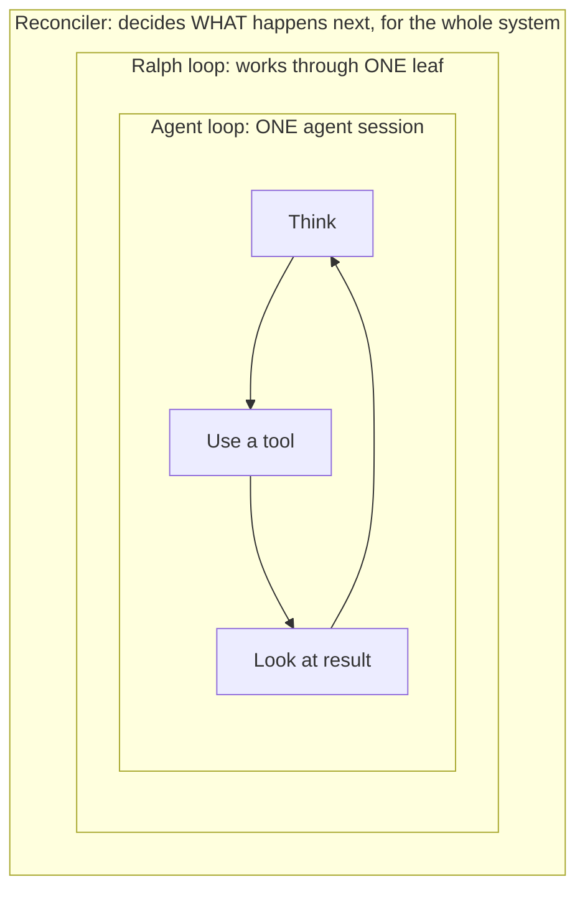
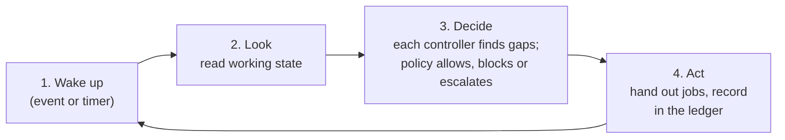

# The reconciler: the harness's heartbeat

> Part of the Agent Harness OS concept docs. New here? Start with [00-overview](00-overview.md).
> Examples, commands and formats are **illustrations**, not final designs.

## The problem

Earlier docs keep mentioning "the reconciler" or "the harness loop" as the thing that keeps work moving.
That raises practical questions: what exactly is it, is it the same as the other loops we've talked about,
is it an orchestrator, how do you start it, how do you stop it, and what is it allowed to do?

## The idea in four sentences

The reconciler is a **long-running background program** that keeps comparing *what should be true*
(the Work Nodes) with *what is proven true* (evidence in the ledger), and takes the next small step to close
the gap. It **doesn't do the work itself** and **doesn't use AI**: it hands work out to agents, CI and humans,
and keeps track of the results. Because it keeps all its memory in the ledger, it can be stopped and
restarted at any time without losing anything. Starting it never starts any work on its own; only
**gates** (doc 05) do that.

---

## 1. Three loops, not to be confused

There are three loops in the system, nested inside each other:

| Loop | Works on | Run by | Uses AI? | Described in |
|---|---|---|---|---|
| **Reconciler** (= "harness loop") | The whole system's work tree | The harness engine | **No**, plain, predictable code | This doc |
| **Ralph loop** | One leaf | Started by the reconciler's build controller | The agents inside it do | [doc 02 §7](02-recursive-v-model.md) |
| **Agent loop** | One agent session (think → use a tool → look at the result) | The AI coding tool (Copilot, Claude Code, …) | Yes, this *is* the AI model | n/a |



So "the harness loop" and "the reconciler" are two names for the same thing. The Ralph loop and the agent
loop are **workers** that the reconciler starts and watches.

---

## 2. Is it an orchestrator?

**Partly.** It decides what happens next and hands out work, which is what orchestrators do. But it differs
from a classic workflow orchestrator in an important way:

| Classic workflow orchestrator | Reconciler |
|---|---|
| Runs a **fixed script**: step 1, then 2, then 3 | Has **no script**. Every round it looks at the current state and asks "what's missing?" |
| Remembers "I'm at step 2" in its own memory | Remembers **nothing**. Everything is in the ledger. |
| A change halfway through means restarting or patching the run | A change halfway through is just a new state. The next round handles it (doc 02 §9). |
| A crash can leave a run half-finished | A crash is harmless; after restart it simply looks again |

The pattern comes from **Kubernetes**, where controllers keep a cluster matching what was asked for. A good
everyday picture is a **thermostat**: it doesn't plan the heating for the day; it keeps checking the
temperature and switches the heater on or off.

**A dispatcher, not a manager.** The reconciler is closer to a careful clerk than a boss: it follows the
rules, hands out jobs, writes everything down and calls a human when something doesn't fit. All judgement
(how to split a story, how to write the code, whether the tests are good) is done by **agents** or
**humans**, never by the reconciler itself.

### Why no AI inside the reconciler?

| Reason | Explanation |
|---|---|
| **Predictable** | The same state always leads to the same decision. That can be tested and explained. |
| **Auditable** | A safety assessor can read the rules. "The AI felt like it" is not an acceptable reason. |
| **Safe** | Ticket text is data, not instructions. A reconciler that doesn't read prose can't be tricked by it. |
| **Cheap and fast** | Running a round costs milliseconds, not AI tokens. |

---

## 3. How one round works

Every round follows the same four steps:



1. **Wake up.** Something happened (see §4), or the timer went off.
2. **Look.** Read the **working state** from the ledger: open nodes, claims, flags, evidence
   (doc 04 §6). Never the whole history.
3. **Decide.** Each controller looks for its kind of gap ("this leaf is Ready and its gate is open, but
   nobody is building it"). Every proposed step goes past the **policy** controller first.
4. **Act.** Start the step (start an agent, trigger CI, post a question) and **record it in the ledger
   before** doing it, so a crash in between can't cause the same step to run twice.

**Steps are safe to repeat.** If the reconciler isn't sure whether a step already happened (for example
after a crash), doing it again must not cause harm. Starting an agent for a leaf that already has an active
claim is simply refused.

---

## 4. What wakes it up

| Trigger | Examples |
|---|---|
| **Signals** (doc 05) | A `harness:build` label, a `/harness pause` comment, a CLI command |
| **Tracker changes** | A spec was edited, a ticket was closed by a human |
| **Repo and CI events** | A change was submitted, a pipeline finished, a merge happened |
| **Agent reports** | An agent submitted its work, asked a question, or gave up |
| **Timers** | A claim is about to expire, a budget check, a settling time ended (doc 02 §9) |
| **Regular full check** | Every few minutes it checks everything, in case an event got lost |

Events make it **fast**; the regular full check makes it **reliable**. Neither is enough on its own.

---

## 5. What it can do, and what it can't

### It can

| Job | Example |
|---|---|
| **Run the controllers** | Breakdown, interface, build, check, integration, policy (doc 02 §7) |
| **Hand out and take back claims** | Give a leaf to one agent; reclaim it if the agent goes silent and its claim expires |
| **Keep budgets** | Stop a Ralph loop at its round, time or cost limit; spot "no progress" |
| **Notice change** | Mark proof as stale when a spec's fingerprint changes; redo only what's affected (doc 02 §9) |
| **Retry** | Retry a failed CI run or tool call a few times, with growing waits in between |
| **Escalate** | Set the `escalated` flag and tell the right human (doc 06) |
| **Keep copies up to date** | Update tracker status, snapshots and labels through the adapters (doc 03, doc 06) |
| **Respect pauses and freezes** | Hold back paused or frozen parts of the tree |

### It can't

| Not allowed | Why |
|---|---|
| Write code, specs or tests | That's agent work, done in a sandbox |
| Judge quality | That's for verifier agents, checks and humans |
| Mark something proven without evidence | Output is a proposal until there's evidence |
| Open a gate | Only a deliberate signal from an allowed person does (doc 05) |
| Change the policy rules or its own code | Rule changes go through review like any other change (doc 04 §9) |
| Act on ticket text as instructions | Ticket text is data, not instructions |

---

## 6. How you start it

The reconciler is a **service that's always running**, much like a CI server. There is normally
**one reconciler per system**, matching the one ledger per system (doc 04 §5). One installation can serve
several systems.

| Setup | How it runs |
|---|---|
| **Simple app** | `harness run` on a laptop while working, or a scheduled job (e.g. a GitHub Action every 10 minutes) that does one round and exits |
| **Team or product** | A small always-on service (a container) next to the ledger database |
| **Large system** | Several copies for reliability, but **only one acts at a time** (the others stand by and take over if it fails). This avoids two reconcilers handing out the same work. |

**Starting the reconciler does not start any work.** When it starts, it just catches up with the current
state. If no gates are open, it sits idle. Work only begins when someone opens a gate (doc 05). That way,
deploying a new version of the harness or restarting the server can never accidentally set agents loose.

```text
$ harness run --system cluster-ui
reconciler started  (system: cluster-ui, engine v1.4.2, policy rev 7f3c)
caught up: 42 open nodes, 3 active claims, 0 open gates waiting
idle: waiting for events
```

---

## 7. How you stop it

There are four levels, from gentle to hard:

| Level | How (illustration) | What happens | When to use it |
|---|---|---|---|
| **Pause part of the tree** | A signal: `harness:pause` label, `/harness pause`, or `harness pause AUTO-123` | That node and everything below it stops after the current step; the rest of the system continues | One Epic needs rethinking |
| **Drain** | `harness drain --system cluster-ui` | No new work is handed out. Running rounds finish and submit. Then it goes idle. | Before maintenance or an upgrade |
| **Stop the program** | A normal shutdown of the service | Always safe. Running agents carry on until their claims expire; after restart it picks up from the ledger. | Restarts, deploying a new version |
| **Emergency stop** | `harness halt --system cluster-ui`, which sets a **kill switch** flag in the ledger | All sandboxes are stopped **at once**, agent credentials are revoked, nothing new starts | Something is clearly going wrong (e.g. an agent misbehaving or a security alarm) |

**Important properties:**
- **The emergency stop lives in the ledger, not in the program.** So it also holds after a restart, and
  every copy of the reconciler obeys it. Only a human with the right permission can clear it, and clearing
  it is recorded.
- **Stopping the program is not the same as stopping the agents.** Agents run in their own sandboxes. A
  normal stop lets them finish their round; only the emergency stop cuts them off.
- **Agents can't keep going without it.** Agents need a valid claim to submit work. Claims expire if the
  reconciler doesn't renew them, so a reconciler that is gone for a long time naturally winds down all
  agent work.
- **Every stop and restart is recorded** in the ledger with who did it and why.

---

## 8. What can go wrong, and how it's handled

| Problem | Handling |
|---|---|
| The reconciler crashes | Restart; it reads the working state and carries on. Nothing is lost. |
| Two copies run at once by mistake | Only the one holding the "leader" lock may act; the ledger refuses writes from the other |
| An event is lost (e.g. a webhook) | The regular full check finds the gap a few minutes later |
| An agent goes silent | Its claim expires; the leaf goes back to Ready and the attempt is recorded |
| The ledger is down | The reconciler stops acting (safe stop, doc 04 §7) and resumes when it's back |
| A tracker is down | Work continues; tracker updates are queued and sent later (doc 03) |
| It keeps retrying something that will never work | Retry limits; then `blocked` or `escalated` |

---

## 9. Tiny app vs. large system

| | Tiny app | Large system |
|---|---|---|
| Where it runs | Laptop or a scheduled CI job | Always-on service, with standby copies |
| Wakes on | CLI commands and a timer | Webhooks, CI events, agent reports and a timer |
| Controllers in use | Build, check, policy | All, including interface and integration |
| Stopping | Ctrl-C | Drain, then stop; emergency stop available to on-call staff |

The **engine is the same**; only the setup differs.

---

## 10. Connections to the other docs

| Topic | Where |
|---|---|
| Controllers, Ralph loop, lifecycle, flags | [doc 02](02-recursive-v-model.md) §6–7 |
| Spec changes while work is running | [doc 02](02-recursive-v-model.md) §9 |
| Tracker updates and change detection | [doc 03](03-tracker-adapters.md) |
| Engine as its own repo, ledger, working state, deployment | [doc 04](04-where-the-harness-lives.md) |
| Gates and signals that start, pause and resume work | [doc 05](05-starting-and-steering-work.md) |
| Seeing what the reconciler and agents are doing | [doc 06](06-seeing-what-the-harness-is-doing.md) |

---

## 11. Open questions

- How often should the regular full check run, and should that depend on the profile?
- How long should claims last before they expire, and should that depend on the type of work?
- Who may use the emergency stop, and who may clear it? Should clearing it need two people?
- Should one installation serve many systems, or should high-risk systems get their own installation?
- How do we test the reconciler's rules themselves (for example, by replaying recorded ledger states)?
- Should the scheduled-job setup for simple apps be the default, with the always-on service only when needed?
