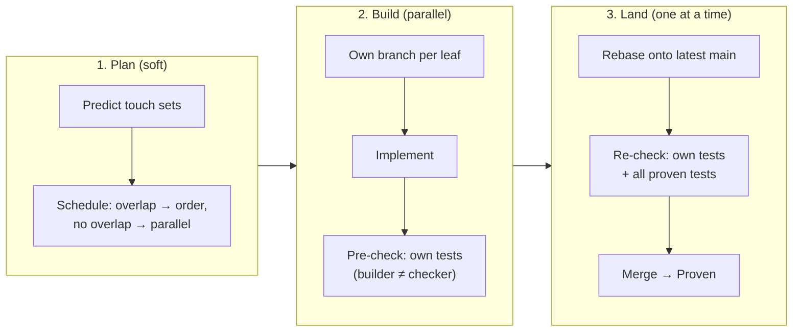

# Leaves and parallel work: where to cut, and how many agents share one codebase

> Part of the Agent Harness OS concept docs. New here? Start with [00-overview](00-overview.md).
> Examples, commands and formats are **illustrations**, not final designs.

## The problem

Doc 02 says a requirement is broken down until the pieces are small enough to build (the leaves). Two
practical questions follow:

1. **Where exactly are leaves cut?** Real stories rarely fit one component. A typical story touches a model,
   a service and a screen, often in different packages.
2. **What happens when many agents build leaves at the same time in the same codebase?** People have long
   handled this by working in parallel and sorting out conflicts at merge time. That allows parallel work,
   but it lets problems slip through to later stages. Locking files or components avoids conflicts, but it
   kills parallelism and feels unnatural.

We want something that feels like how teams already work, doesn't force a particular application
structure, and keeps working when there are far more agents than there ever were people.

## The idea in four sentences

A leaf is cut around **one change that can be delivered, verified and owned as a whole**, not around a
component, so a leaf may touch several components (a *vertical slice*). Agents build leaves **fully in
parallel**, each on its own branch, with no locks on code. Every change then passes through **one landing
point** (a merge queue) where it is re-checked on top of the very latest code, together with the acceptance
tests of everything already proven, and only then merged. A leaf counts as *proven* only after it has
landed, so the main branch is always green and the safety net grows with every leaf delivered.

---

## 1. Where leaf boundaries go

### Horizontal or vertical?

| | Horizontal: one leaf per component | Vertical: one leaf per behaviour |
|---|---|---|
| Example | "Add API client", "Add data model", "Add view" | "User sees today's temperature" (touches UI, service and model) |
| Acceptance tests | Technical, per part | Observable behaviour, close to the user story |
| Value of one proven leaf | Little until everything is put together | Real: something works |
| Where problems show up | Late, when parts are integrated | Early, in the leaf itself |
| Size per agent run | Small | Larger |

User stories are vertical by nature. Forcing them into one-component pieces turns stories into tasks and
pushes all meaningful testing up to integration. **Prefer vertical slices.**

### The rule: one atomic, uniformly verifiable change

A leaf may touch **any number of components**, as long as all four of these hold. This sharpens the
"one target" line of the leaf check in [doc 02 §4](02-recursive-v-model.md):

| Rule | Plain meaning | Why it matters |
|---|---|---|
| **Delivered atomically** | It lands as one change that can be merged or rolled back as a whole: in practice one repo (or one monorepo) | Across repos there is no "merge both or neither" |
| **One way of proving it** | All touched code falls under the same profile: same checks, same evidence, same reviewers | A safety-rated part needs different proof than a settings screen |
| **One owner** | One team and one tracker are responsible | Hand-offs between teams are dependencies, not leaf internals |
| **Fits one agent run** | Small enough to build and fix within the attempt limits | Otherwise the Ralph loop can't finish it |

The boundaries come from **delivery, safety and ownership**, not from the code's folder structure. Within
those limits, the decomposer is free to cut vertically.

### What a forced split adds

When one of the rules fails, the work is split, and each kind of split brings a specific extra piece:

| Boundary crossed | Split into | Extra piece |
|---|---|---|
| Repo | One leaf per repo | An **interface node** first (agree the contract), then an **integration node** to check the parts together (doc 02 §5) |
| Profile | One leaf for the stricter part, one for the rest | The stricter leaf gets its own, stricter evidence |
| Team or tracker | Your leaf, plus a **dependency** on the other team's item | A `depends-on` link; your leaf waits (doc 03) |
| Size | Several leaves, ordered by their dependencies | Nothing special |

### The touch set

Each leaf records which components it expects to change: its **touch set**. The decomposer predicts it and
the harness uses it for scheduling (§4). It is a prediction, not a fence: if the implementer finds it
needs one more component **in the same repo and profile**, that is fine and simply recorded. If the extra
component is in another repo or profile, the leaf rules are broken, so the harness stops and re-plans with
a human (doc 02 §8, pushing back).

---

## 2. Tests and evidence for a leaf that touches many components

| Question | Answer |
|---|---|
| Where do the leaf's acceptance tests live? | In a test target that belongs to **the node** (not to one component) and may use all components in its touch set. It tests the behaviour across them. |
| What may the implementer not change? | That node's test files, and the test files of every other node. Their fingerprint is fixed when they are written. |
| What does the evidence record? | The exact commit it was checked on. A commit covers every component at once, so "which versions were tested together" is never ambiguous. |
| What happens to a node's tests after it is proven? | They stay. From then on they guard that behaviour against every later change (§5). |

---

## 3. Many agents, one codebase: why not locks?

The obvious safe answer is a lock: "while an agent works on `WeatherService`, nobody else may". It looks
neat, but:

- It **serialises** exactly the parts of the system that matter most, because popular components are popular
  for a reason.
- It feels unnatural: no team works like that, and it pushes people to split code just to dodge locks.
- It still doesn't prevent **semantic** conflicts: two changes to *different* components can still break each
  other's behaviour.

The other classic answer, "work in parallel and resolve conflicts at merge time", is closer to how people
work. Its weakness was never the parallel work. It was that a merge which was **textually clean but
behaviourally broken** reached the main branch without anyone re-checking the combined result. Agents change
the trade-off:

| | People | Agents |
|---|---|---|
| Redoing or rebasing work | Painful, so people avoid it | Cheap and quick |
| Number of changes in flight at once | Small | Large, so conflicts rise sharply |
| What goes wrong without re-checking | Semantic conflicts reach `main` | The same, only faster |

So the answer is **optimistic concurrency with a strict landing point**: let everyone work in parallel,
and never trust a merge that hasn't been checked on the exact code it lands on. The ledger already works
this way (compare-and-swap, doc 04 §7); this applies the same idea to code.

---

## 4. Three layers: plan, build, land

**1. Plan: avoid conflicts where cheap.** The reconciler uses the predicted touch sets as a *scheduling
hint*: leaves that overlap heavily are ordered one after the other; leaves that don't overlap run in
parallel. This isn't a lock: if the prediction was wrong, layer 3 catches it.

**2. Build: fully parallel and isolated.** Each leaf gets its own branch (and working copy). No agent ever
sees another's half-finished code. When the implementer submits, a separate verifier runs the leaf's own
acceptance tests on the branch. This *pre-check* gives fast feedback without waiting for the queue.

**3. Land: one ordered landing point.** Passing leaves join the **landing queue**. One at a time, each
change is:
1. rebased onto the current main branch,
2. checked again there: its own acceptance tests **plus the acceptance tests of every proven node** (the
   regression suite),
3. merged, and only then is the node **proven**. The evidence describes the merged result, not a branch
   that no longer exists.

The only part that runs one at a time is the landing point. Agents never wait for each other while working.

---

## 5. When landing fails

| What happened | What it means | What the harness does |
|---|---|---|
| **Textual conflict** while rebasing | Someone else landed a change to the same lines first | **Rework**: throw away the implementation, keep the (unchanged) acceptance tests, start again from the latest main. Rework is counted separately from failed attempts; it isn't the agent's fault |
| **The leaf's own tests fail** after rebasing | Someone else's change affects this leaf | Back to the implementer, as a normal attempt |
| **Another node's acceptance tests fail** | This change breaks behaviour that was already proven | Possibly a **requirements conflict**: two approved requirements contradict each other. **Escalate to a human.** An agent must never "fix" it by changing the other node's tests |

The third row is where parallel agentic work becomes safer than the old way. Every proven node leaves its
acceptance tests behind as a guard, so contradictions between requirements, even ones written months apart
by different people, show up at landing with both requirements named. A human then decides which one wins,
and the losing requirement goes through the normal change process (doc 02 §9).

Repeated rework on the same leaf is a signal too: something keeps landing in the same place. After a limit
(per profile), the harness escalates or asks the planner to order the overlapping work.

---

## 6. Why this scales

- **The safety net grows with the work.** More leaves delivered means more acceptance tests guarding `main`.
  The cost of a bad merge goes down as the system grows, not up.
- **Only landing is serial, and landing is a known, solved problem.** Large monorepos land thousands of
  changes a day with techniques that fit straight in:
  - **Batching:** check several queued changes together; if the batch fails, split it to find the culprit.
  - **Affected tests only:** use the dependency graph to run only the tests that the change can affect.
  - **Speculative checks:** check the next changes in parallel, as if the ones ahead of them will land.
  Examples are GitHub merge queue, bors and the internal queues at Google and Uber.
- **It feels familiar.** It is branch → pull request → merge, as people know it. The only difference is
  that the queue, not a person, decides when it's safe to press merge.
- **Across repos, the same idea one level up.** There's no atomic merge across repos, so cross-repo work is
  split (§1), contracts are agreed first, and integration nodes check the combination (doc 02 §5). Each repo
  has its own landing queue.

### Per profile

| Profile | Landing |
|---|---|
| Simple app | Queue of one; rebase, run all tests, merge. Seconds to minutes |
| Bigger product | Batching and affected-tests-only |
| Safety-relevant | A human review is required before landing. If the rebase changes code the reviewer saw, the review is redone for those parts. Landing evidence must include the review record |

---

## 7. Locks only for scarce things

Locks don't go away completely; they move to things that really can't be shared:

- a hardware test bench (HIL) or a test vehicle,
- a database migration or another one-way step,
- a release or a sealing step,
- a component whose review is expensive and booked in advance.

These become **leases** in the ledger, with a time limit, just like agent claims (doc 07).

## 8. Effect on application structure

The harness doesn't force a structure, but it **measures friction**. The ledger records every rework and
every requirements conflict per file and component, so hotspots become visible: central registries,
dependency-injection setup, routers, build manifests, project files. The harness can then *suggest* a
change, such as generating the registry instead of editing it by hand, making a file append-friendly, or
splitting a component that everyone touches. Teams have always felt this pressure towards modularity; here
it becomes data instead of folklore.

A simple example: a build manifest that lists every module is a classic conflict magnet. If the harness
generates it from the folder structure instead, it can never conflict.

---

## 9. In the simulator

The [simulator](AgentOS/HarnessApp) shows this in miniature with a real git repository:

- The workspace is one monorepo. A leaf's touch set can name several components.
- Every leaf has its own branch and working copy (git worktree). Each node's acceptance tests live in its own
  test target.
- The build manifest (`Package.swift`) is generated from the folders and never committed, so it can't
  conflict (§8).
- Passing leaves go through a landing queue: rebase, then *all* tests, then a fast-forward merge.
- The demo shows parallel leaves causing a textual conflict that is reworked automatically, and a second epic
  whose requirement contradicts the first, which is escalated as a requirements conflict.

Not simulated: scheduling by touch set (layer 1), multiple repos and their integration nodes, batching, and
review gates before landing.

## 10. Open questions

- How good can touch-set predictions be, and is it worth scheduling on them, or is optimistic plus rework
  cheaper in practice?
- How many reworks before the planner should step in and order the work?
- When a requirements conflict is found, who is asked: the owner of the new requirement, the old one, or both?
- How long may the landing queue get before throughput, rather than agent capacity, becomes the bottleneck?
- Should pre-checks on the branch be skipped for cheap test suites and everything checked only at landing?
