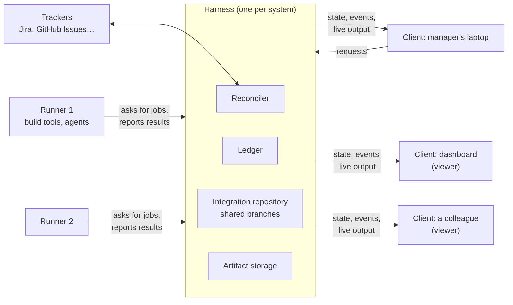
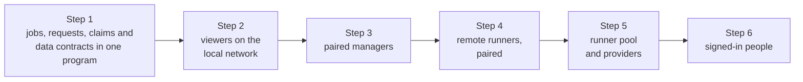

# Runners and clients: the harness, the machines that do the work, and the people using it

> Part of the Agent Harness OS concept docs. New here? Start with [00-overview](00-overview.md).
> Examples, tables and YAML are **illustrations**, not final formats.

## The problem

The simplest harness is one program on one machine. It decides what to do, runs the agents, builds and
tests the code, and shows it all in one window. That stops being enough quite soon:

- Builds and tests are heavy. They want an **always-on machine with the right tools** (compilers, SDKs,
  simulators, test hardware), while the person following the work sits at a laptop.
- One machine can only run so many agents at once. Sooner or later you want **more than one machine**
  doing the work, sometimes of different kinds (one for Apple platforms, one for Linux, one with a test bench).
- How many machines are needed **changes over time**: a big requirement may want five, a quiet week none.
- **Several people** want to follow the work at the same time, from wherever they are, and some of them
  want to **steer it** from there too, not only from the machine the harness runs on.

So the program that decides, the machines that work and the screens people use need to be separable,
without making the simple one-machine setup any harder.

## The idea in four sentences

The harness is split into three parts: the **harness** itself, which decides and records (one per system),
**runners**, which do the heavy work (any number), and **clients**, through which people watch and steer
(any number, as a **viewer** or a **manager**). The harness hands runners self-contained **jobs** under a
time-limited **claim**, and runners report the results back. Clients only ever send the harness **requests**:
only the harness writes the ledger, moves shared branches and makes the harness's own tracker updates.
People keep using the tracker as they always have. On a single machine all three
live in one program and use the same contracts, so growing from a laptop to a fleet is a change of setup,
not of design.

---

## 1. Three parts

| Part | Does | How many | Needs | Never does |
|---|---|---|---|---|
| **Harness** | Runs the reconciler (doc 07), keeps the ledger, keeps the trackers up to date, owns the shared branches, decides what runs where | **One active** per system (doc 07 §6: one leader) | Git, ledger storage, tracker credentials. **No** build tools. | Run agents or builds itself (except in the one-machine setup, where a runner lives inside it) |
| **Runner** | Does jobs: agent runs, checks, baselines, landing checks | **Zero or more**, added and removed while work goes on | The repo's tools (compilers, SDKs, simulators, test hardware), a login for the agent tool, disk space | Write the ledger, touch the tracker, push to shared branches, decide what happens next |
| **Client** | Shows the work tree, the attention list, what is running now and its live output. For a **manager**, also everything else people do with the harness today (§8) | **Any number**, coming and going | Network access to the harness | Change anything directly: it sends requests, the harness decides |



### Why split it this way?

| Reason | Explanation |
|---|---|
| **Different needs** | The harness is small but must always be on. Runners are big and may sleep. Clients come and go. |
| **Different trust** | Runners run code that agents just wrote. Keeping the tracker credentials and the ledger on the harness means a job that goes wrong can't reach them. |
| **One writer** | Like the ledger (doc 04), shared branches and the harness's tracker updates (statuses, its comments, child tickets) have exactly one writer, so two machines can never disagree about what happened. |
| **Scaling** | More work means more runners. Neither the harness nor the clients change. |

---

## 2. Jobs: what the harness hands to a runner

A **job** is one self-contained piece of work. It carries everything the runner needs, so the runner never has
to read the ledger or the tracker:

| Part | Example |
|---|---|
| **IDs** | Job ID, plus the node and run IDs (doc 06 §7), so everything the runner reports can be traced back |
| **Kind** | An agent run in a given role (breakdown, test author, implementer, reviewer), a check, a baseline, a landing check |
| **Starting point** | The commit to start from, and the name of the branch to deliver the result on |
| **Instructions** | The agent's context, as data (ticket text is data, not instructions: doc 07 §2) |
| **Limits** | Time and cost budget, tools the agent is denied, which model to use |
| **Requirements** | What the runner must offer (§5): operating system, tool versions, a simulator, a test bench |
| **Rules version** | A fingerprint of the policy the job was created under, so the result is tied to the rules it was made under |

A **result** says how it went, which commits it produced, which evidence files belong to it (with checksums)
and the run's full output. It also says **what ran it**: the runner, its tool versions and the agent tool's
version. That way results from different machines can be compared, and a misbehaving machine can be found.

Three rules make this safe:
- **Results are proposals.** As in doc 07, nothing counts until the harness has checked that the result belongs
  to a claim that is still valid, and recorded it.
- **Jobs and results are safe to repeat.** Sending the same job twice must not do the work twice: the job ID
  decides. A runner reports a result until the harness acknowledges it. If the harness already recorded it and
  only the acknowledgement got lost, a repeated report gets the same acknowledgement, not a "late" refusal.
- **The runner never decides what's next.** It reports; the reconciler decides in its next round.

---

## 3. Claims, heartbeats and lost runners

A runner that takes a job gets a **claim** on it (doc 07), with an expiry time. While it works, it renews the
claim with regular **heartbeats**. One rule covers every kind of trouble: **a runner works only while its claim
is valid.** If it can't reach the harness, it keeps working until the claim runs out, then stops the job,
keeps what it has and reports it once it can. Claims are long enough to ride out a short outage (minutes, not
hours).

| Situation | What happens |
|---|---|
| **A runner goes silent** (crash, sleep, network gone) | Its claim expires. The run is recorded as abandoned and the node is ready again, possibly for another runner. It counts as an **infrastructure failure**, not as one of the leaf's attempts. |
| **A runner keeps losing jobs** | It's taken out of rotation and flagged for a person: a broken machine shouldn't use up every leaf's retries. |
| **The harness restarts** | Runners that are separate programs carry on while their claims are valid and keep their results. The harness then **picks up runs whose runner is still there** instead of abandoning them. Work done by a runner inside the harness's own program stops with it and is recorded as abandoned. |
| **A result arrives after its claim expired** | It's refused and recorded as late: the work may already have gone to another runner. (A result that was already recorded is acknowledged again instead, §2.) |
| **A manager stops a run** | The request goes to the harness (never straight to the runner), which tells the runner to cancel and records who stopped it. |
| **Emergency stop** (doc 07 §7) | The stop is a flag in the ledger. The harness tells every runner it can reach to stop at once, and renews no claims. A runner it can't reach stops when its claim runs out, so the emergency stop is immediate for reachable runners and takes at most one claim period for the rest. A runner that reconnects asks first whether a stop is in force, before it reports or takes work. |

A claim is handed out as a **duration** since the last renewal the harness acknowledged. The runner measures it
with its own steady clock, and the harness with its own, plus a small margin. Wrong wall clocks therefore
can't cause trouble.

---

## 4. Runners ask for work; the harness doesn't push it

Runners **connect to the harness and ask for jobs**, the way self-hosted CI runners do. The harness never
connects to a runner.

- Runners can sit behind firewalls, on a home network, or on a laptop that goes to sleep.
- Adding a runner means starting it and pointing it at the harness. The harness doesn't need a list of
  addresses.
- A busy runner simply doesn't ask, so the harness never overloads one.

---

## 5. What a runner can do, and how much at once

Each runner declares its **capabilities** and its **slots**:

| Runner | Capabilities | Slots |
|---|---|---|
| Build machine in the office | Apple platforms, toolchain version X, phone simulators | 3 agent runs, 1 UI test run (it needs the simulator and the screen) |
| Linux server | Linux, containers | 4 agent runs, 4 checks |
| Lab PC | Test bench `hil-bench-2` attached | 1 hardware test |

Each job says what it needs, usually from the repo's config and the policy (doc 01, doc 04). The harness
gives a job only to a runner that offers all of it, and only when that runner has a free slot of the right
kind. Scarce things attached to one runner, such as a test bench, become **leases** (doc 08 §7).

The policy's own limits (for example "at most 5 agents at once for this system", budgets) still apply. The
real limit is the smaller of the two: what the policy allows, and what the runners can take.

---

## 6. How many runners: a configured pool

The harness's settings describe a **runner pool**:

- **Registered runners**: machines that connect by themselves. The harness uses whichever are connected.
- **Runners started on demand**: a **runner provider** starts runners when jobs are waiting and stops them when
  they've been idle for a while. It might wake a sleeping machine, start a virtual machine, or rent a cloud
  machine. Providers are adapters, like tracker adapters (doc 03).

```yaml
# illustration
runners:
  pool:
    - provider: registered        # machines that connect by themselves
      max: 3
    - provider: virtual-machines  # started on a host while jobs wait
      host: build-host-1
      min: 0
      max: 2
      stop_when_idle: 30m
  monthly_cost_limit: 200 EUR
```

Changes to the pool are recorded in the ledger like any other setting, with who changed it.

**Look at the queue, not at single jobs.** Some platforms rent machines for a minimum period, such as a day.
Starting one for each waiting job would be expensive, so a provider decides based on how much work is
waiting and for how long.

---

## 7. How code travels between machines

Runners need code to start from, and they produce code. The harness owns the **integration repository**:
the shared branches where proven work lands (doc 08). The rules:

1. A runner keeps its own **cached copy** of the repository and fetches the job's starting commit from the
   harness.
2. It returns its commits on a branch named after its run, **never** a shared branch.
3. **Landing stays with the harness.** The harness merges (quick), hands the merged commit to a runner as a
   **landing check job** (slow), and moves the shared branch only if that check passes. One writer for shared
   branches, just as for the ledger.
4. The **runner program** moves the code, not the agent. Agents still can't push or fetch themselves.
5. The product's own remote (GitHub, GitLab…) only sees what the harness **publishes**, such as a pull request.

---

## 8. Clients: viewers and managers

A client is what a person uses to follow and steer the harness: an app window, a dashboard, a command line.
It uses the two data contracts of doc 06: **current state** (ask a question, get an answer) and the **event
stream** (what happens, in order). It adds two things for watching live: an agent run's **live output** and
the **evidence files**.

- **Everything comes from the harness.** Clients never connect to runners. Runners send their output to the
  harness, which keeps it as an artifact, so a client sees the same output live or a week later.
- **Resume where you left off.** The event stream is read from a position. A laptop that wakes up continues
  from the last event it saw instead of reloading everything.
- **Watching doesn't slow the work.** Clients read copies (doc 04 §7), so ten people watching doesn't hurt the
  agents.
- **Easy to find.** On a local network, the harness announces itself (service discovery), so a client finds
  it without anyone typing an address.

### Two roles

| Role | May | Typical person |
|---|---|---|
| **Viewer** | Watch everything their access allows: the tree, the attention list, live output, evidence, the ledger | A colleague, a stakeholder, a wall dashboard |
| **Manager** | Everything a viewer may, **plus everything a person can do with the harness on its own machine** (table below) | Whoever runs the work |

**The roles cover the harness, not the tracker.** Labels, comments and tickets belong to the tracker
(doc 03), so the **tracker's own permissions** decide who may add them, whatever their role in the client.
A client therefore offers them to viewers too, and sends them **straight to the tracker with the person's own
tracker login**, not through the harness. The harness then sees the label like any other signal: the profile
decides whether that person may open that gate (doc 05), exactly as if they had added it in the tracker's
own web page. The tracker shows who did it, and nobody gains rights by using a client. A client without a
tracker login on that machine shows these actions as links into the tracker instead. Only with a tracker
the harness keeps itself (a local tracker, no outside system) do these go to the harness as requests, and
then they need the manager role.

**A manager has full control, but only through requests.** Every harness action from a client is a
**request** to the harness: a command, a stop or a settings change. The harness checks it against the policy like
any other signal (doc 05), records it in the ledger **under the person's name**, and then acts on it. The client never
changes state itself. That's why "full control from another machine" is safe: the harness doesn't trust the
client, it trusts the policy. It also means two managers can act at the same time: their requests are
recorded in order, and an edit based on an outdated version is refused, as in the ledger itself (doc 04).
Each request has its own ID, so a request sent again after a dropped connection isn't carried out twice.

What a person can do, and how it works from a client:

| Kind | Examples | From a client |
|---|---|---|
| **Watch** | Work tree, attention list, running agents and their output, evidence, ledger, findings | Viewer and manager |
| **Work in the tracker** | Signals as labels (gates, retry, replan), answering questions in comments, creating and editing tickets | Any role, if the person may do it in the tracker: sent with their own tracker login (see above) |
| **Steer the harness** | Stopping a run, pausing or draining the harness, rerunning the scan or the baseline, checking the ledger's hash chain | Manager |
| **Change the harness's own settings** | Publishing on or off, which models agents use, review levels, which signals are allowed | Manager, recorded in the ledger with old and new value. These are the outer limits (doc 04 §8), so stricter profiles take them from the rules repo instead, and no client can change them. |
| **Connect machines** | Pairing a runner or a client, removing one | Manager. A new runner or manager is announced on the attention list, so nobody is added quietly. |
| **Emergency stop** (doc 07 §7) | Stop all agents of a system at once | Manager. Clearing it may need a second person (doc 07, open questions). |
| **Things on one machine** | Open a working copy in an editor, show a file in the file browser | Not remotely. Instead the client shows the changes and files it gets from the harness, or fetches the run's branch into the person's **own** copy of the repo and opens it there. |

---

## 9. Who may connect: start simple, end strict

| Step | Viewers | Managers | Runners |
|---|---|---|---|
| **1. Local network** | Anyone on the same local network may view. This is a **setting that is off by default**, and the harness clearly shows when it's on. Tracker actions work with each person's own tracker login. | Only at the harness's own machine | **Paired** once with a code shown by the harness, even on a local network. Pairing exchanges keys, so the connection is authenticated and encrypted from the start. |
| **2. Paired devices** | Each viewer device is paired once and can be removed later. Traffic is encrypted. | A device paired **for a named person** with the manager role, over an authenticated, encrypted connection. Their requests are recorded under that name. | Paired, encrypted |
| **3. People, not devices** | People sign in with the identity they use in the tracker (company sign-in, a GitHub account…). Each person sees only the systems they're allowed to see. | The role comes with the sign-in, per system. | Each machine has its own identity, and its credentials are replaced regularly |

**A manager is never anonymous.** "Anyone on the local network" is fine for watching. Steering needs a name in
the ledger, because the ledger says who did what (doc 04), so managers start at step 2.

Why are runners stricter than viewers from day one? A viewer can only look. **A runner's output becomes
code**: a fake runner could hand in commits that end up being landed. Pairing costs little and closes that hole.

What "anyone on the local network may view" means: anyone on that network can read the work tree, ticket
text, live agent output and code changes. That's fine at home or in a trusted office. It's not fine on a
shared or guest network, which is why it's a setting and not the default.

---

## 10. What this changes in the harness

- **One program, same contracts.** The one-machine setup is the harness, one runner and one client (with the
  manager role) in a single program. They use the same jobs, requests, claims and data contracts, just without
  a network. So the simple setup never needs one, and the split is exercised every day.
- **The window is always a client.** Even on the harness's own machine, the window asks the harness and
  sends requests; it holds no state of its own. A client on another machine can therefore do exactly what
  the local window can, apart from things tied to one machine (§8).
- **Hand out, then record.** The reconciler no longer waits for an agent to finish. It hands out a job, as
  it already records before acting (doc 07 §3), and records the result in a later round. The claim connects the two.
- **Who did it.** The ledger records which runner did each run, and with which tool versions.
- **Versions must match.** When a runner connects, it and the harness agree on a protocol version. A runner
  with an incompatible version is refused and told to update. As doc 04 §9 says, runners run a **released** engine,
  never one that is still being changed.

---

## 11. What can go wrong, and how it's handled

| Problem | Handling |
|---|---|
| A runner disappears | Its claim expires (§3). The node is ready again and the attempt isn't counted against the leaf. |
| Network split between harness and runner | The runner keeps working while its claim is valid (§3) and keeps reporting. If the claim ran out first, the runner stopped, and its result is refused as late. |
| The harness is down | Runners keep working until their claims run out, keep their results and take nothing new. Clients show "harness not reachable". |
| A runner returns wrong work | Landing checks rerun everything on the merged commit (doc 08), which catches a broken runner. |
| A runner is compromised and forges results | Paired runners are **trusted machines**, and a rerun on the same runner proves nothing against one that lies. Stricter profiles therefore require the landing check to run on a **different runner** than the one that built the change (builder ≠ checker, for machines too), and the strictest on machines the organisation controls separately, such as its CI. |
| A runner is unhealthy (full disk, broken tools) | It reports itself unhealthy and takes no jobs. A runner that keeps failing jobs for reasons that aren't the agent's is taken out of rotation. |
| Two harnesses for one system | Only the leader may act (doc 07 §8). Runners and clients connect to the leader. |
| A manager's device is lost | Remove its pairing from any other manager's client. Its requests stop being accepted at once, and what it did stays in the ledger. |

---

## 12. Tiny app vs. large system

| | Tiny app | Large system |
|---|---|---|
| Harness | Inside the one program on a laptop or an always-on machine | An always-on service with standby copies (doc 07) |
| Runners | One, inside the same program | A pool per kind of work, some started on demand, some with test hardware |
| Clients | The program's own window, maybe a laptop on the home network | Dashboards, colleagues' laptops, tracker snapshots |
| Who may connect | Viewers on the local network (step 1), a paired manager laptop (step 2) | Signed-in people with roles; machine identities (step 3) |
| Code transfer | Local, no network | Integration repository served by the harness |

The **harness is the same**; only the setup differs.

---

## 13. What to build first



Step 1 changes nothing you can see, but it turns the later steps into a matter of sending the same things
over a network. Watching comes first because it's useful on its own and read-only, so it carries little risk.
Managers come next: once the window only sends requests (step 1), a paired manager is mostly a matter of
sending those requests over the network and recording who sent them.

---

## 14. How this connects to the other docs

| Topic | Where |
|---|---|
| Engine, ledger, artifact storage, read-only copies, monitoring store | [doc 04](04-where-the-harness-lives.md) |
| Signals and the checks every request goes through | [doc 05](05-starting-and-steering-work.md) |
| The two data contracts, node and run IDs, plug-in rules | [doc 06](06-seeing-what-the-harness-is-doing.md) |
| Claims, the leader, stopping, recording before acting | [doc 07](07-the-reconciler.md) |
| Landing queue, leases for scarce resources | [doc 08](08-leaves-and-parallel-work.md) |

## 15. Open questions

- Should the harness's machine also be a runner in larger setups, or should it always be kept light?
- Whose login does the agent tool use on a shared runner: the runner's own, or the person who opened the gate?
  That decides who pays and whose permissions the agent has.
- Do runners keep caches between jobs (faster), or start clean every time (stricter)? Should stricter profiles
  require clean runners?
- Should stricter profiles always run the landing check on a different runner than the one that built the change?
- How long does a runner keep results while the harness is unreachable?
- How do clients outside the local network connect: a VPN, a relay service, or a hosted harness?
- Is a third role needed, for example an **owner** who alone may change the harness's settings and pair
  machines, or are two roles plus the rules repo for stricter profiles enough?
